# NetPanel – dotykové síťové GUI pro Raspberry Pi 4 + Waveshare 5" DSI LCD

NetPanel je jednoduchá kiosková aplikace pro **Raspberry Pi 4** s dotykovým displejem
**Waveshare 5inch DSI LCD (800 × 480, kapacitní dotyk)** a **Raspberry Pi OS 12 „Bookworm“**.
Přehledně ukazuje stav sítě a umožňuje ji nastavit přímo z displeje:

- **Ethernet** – přepínač **DHCP / Static IP**; v režimu DHCP vidíš IP, masku, bránu a DNS, které rozhraní dostalo.
- **Wi-Fi** – přepínač **Station / Access Point**
  - *Station*: sken okolních sítí, připojení k Open / WPA2-Personal / WPA3-Personal síti, skrytá síť, DHCP nebo statická IP.
  - *Access Point*: SSID, heslo (WPA2), pásmo 2,4 / 5 GHz, kanál, adresa AP; klienti dostanou IP z DHCP a internet přes eth0 (NAT).
- **Tailscale** – stav připojení a **Advertise subnet**: předvyplní subnet podle eth0 a po potvrzení provede
  `sudo tailscale set --advertise-routes=<síť>/<prefix>`.
- **LAN scan** – najde zařízení v přímo připojené síti (rozsah předvyplněný podle eth0, lze změnit) a ukáže tabulku
  **Název / IP / MAC / Výrobce**; tlačítko **Scan / Stop**. Bez root práv a bez nmap.
- Vlastní **on-screen klávesnice** (numerická pro IP adresy, QWERTY pro SSID/hesla) – v kiosku žádná systémová klávesnice není.
- **Přihlášení PINem**: úvodní přehled je vidět bez hesla, každá další obrazovka (Ethernet, Wi-Fi, Tailscale, LAN scan)
  vyžaduje admin PIN. Tlačítko **Logout** na úvodní obrazovce, **automatické odhlášení po 5 min nečinnosti**
  (30 s předem varování), zámek po 5 špatných pokusech.
- Běží jako **služba po bootu ve fullscreenu**; z dotykového displeje ji nejde zavřít ani minimalizovat.

GUI je v angličtině, tato dokumentace v češtině.

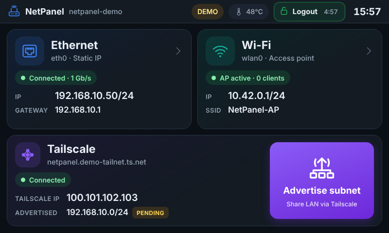

| Ethernet (DHCP) | Wi-Fi – Station | Wi-Fi – Access Point |
|---|---|---|
| 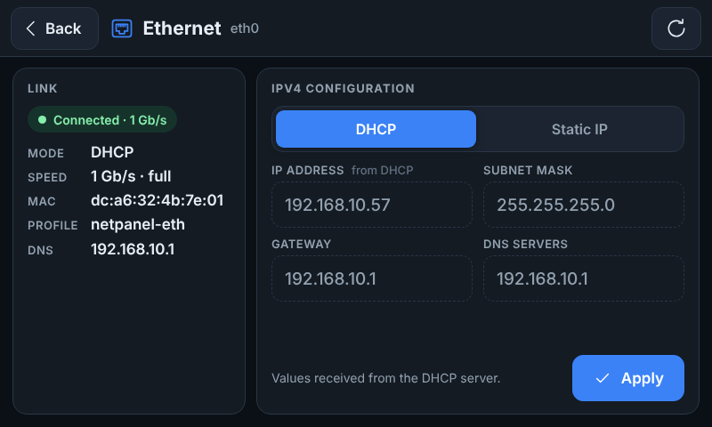 | 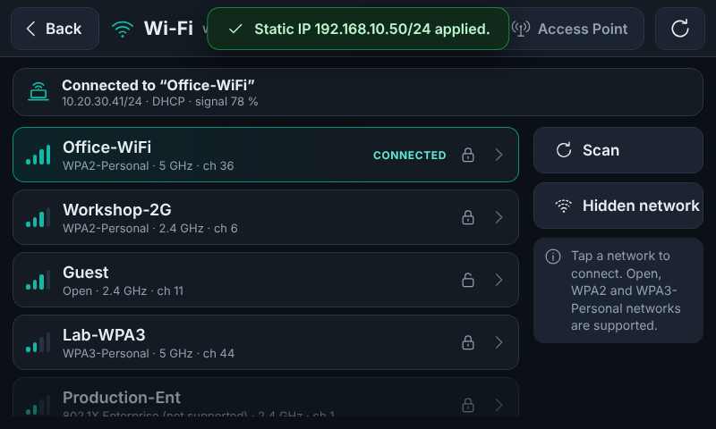 | 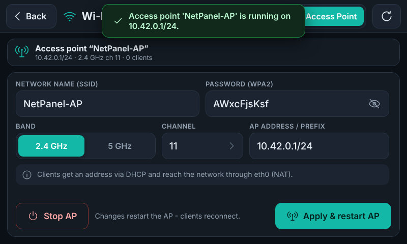 |
| **Numerická klávesnice** | **QWERTY klávesnice** | **Tailscale – Advertise subnet** |
| 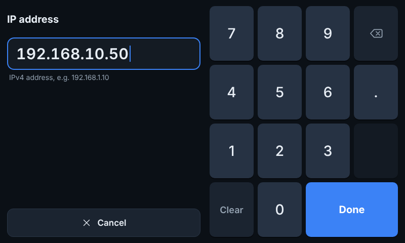 | 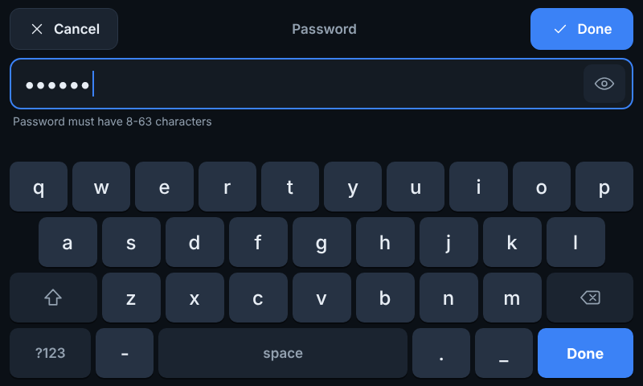 | 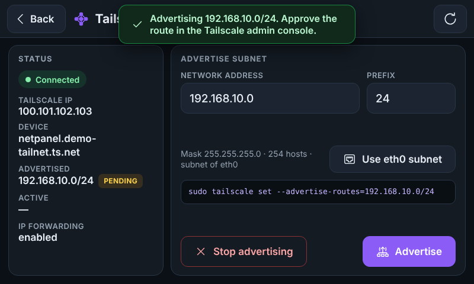 |
| **Login (PIN)** | **Přihlášeno – Logout + odpočet** | **Varování před auto-logoutem** |
| 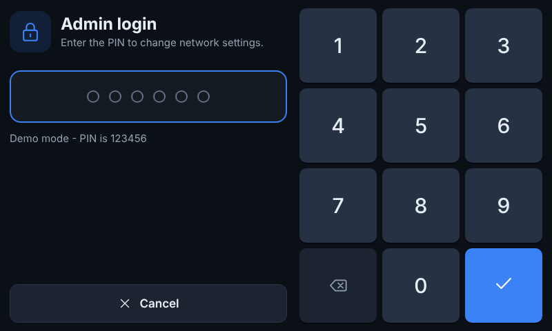 |  | 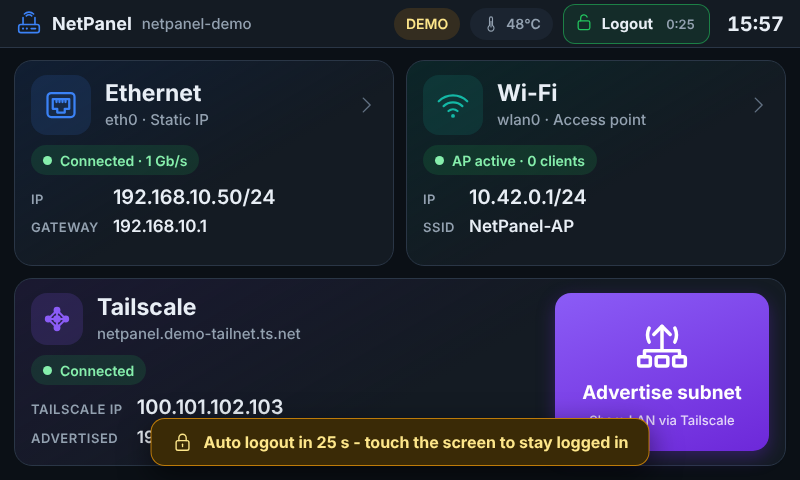 |
| **LAN scan – výsledky** | **LAN scan – detail zařízení** | **LAN scan – rozsah mimo lokální síť** |
| 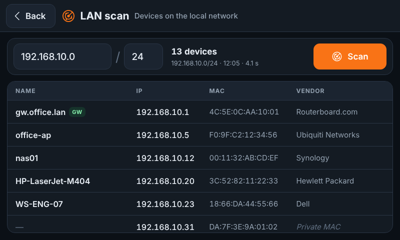 | 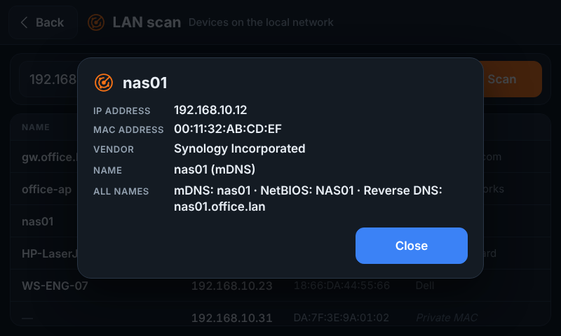 | 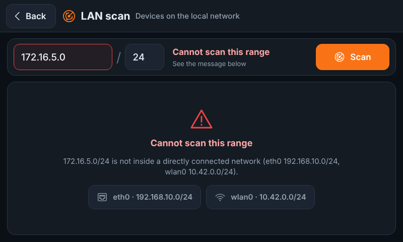 |

Všechny obrazovky jsou v [`docs/screenshots/`](docs/screenshots/) (vygenerované v demo režimu, 800 × 480).

> **Status: pracovní verze.** Kód je otestovaný unit testy a v demo režimu (simulovaný backend) v prohlížeči
> 800 × 480. **Na reálném Raspberry Pi s tímto displejem zatím otestovaný nebyl** – před nasazením
> do provozu ho musí ověřit odpovědná osoba (viz [Známá omezení](#známá-omezení-a-kritické-poznámky)).

---

## Obsah

1. [Jak to funguje](#jak-to-funguje)
2. [Struktura projektu](#struktura-projektu)
3. [Požadavky](#požadavky)
4. [Instalace krok za krokem](#instalace-krok-za-krokem)
   - [Displej: KMS vs. legacy (černá obrazovka po instalaci)](#displej-kms-vs-legacy-černá-obrazovka-po-instalaci)
   - [Dotyk nefunguje](#dotyk-nefunguje)
   - [Oprávnění: „Insufficient privileges“](#oprávnění-insufficient-privileges)
5. [Co přesně dělá instalátor](#co-přesně-dělá-instalátor)
6. [Kiosk: služba po bootu, fullscreen, nejde zavřít](#kiosk-služba-po-bootu-fullscreen-nejde-zavřít)
7. [Ovládání GUI](#ovládání-gui)
8. [LAN scan: jak funguje a co od něj čekat](#lan-scan-jak-funguje-a-co-od-něj-čekat)
9. [Přihlášení: admin PIN a automatické odhlášení](#přihlášení-admin-pin-a-automatické-odhlášení)
10. [Bezpečnost a oprávnění](#bezpečnost-a-oprávnění)
11. [Konfigurace](#konfigurace)
12. [Vývoj a testy na PC (demo režim)](#vývoj-a-testy-na-pc-demo-režim)
13. [Řešení problémů](#řešení-problémů)
14. [Známá omezení a kritické poznámky](#známá-omezení-a-kritické-poznámky)
15. [Aktualizace a odinstalace](#aktualizace-a-odinstalace)
16. [Licence a zdroje](#licence-a-zdroje)

---

## Jak to funguje

```
 ┌───────────────────────── Raspberry Pi 4 ──────────────────────────────┐
 │                                                                       │
 │  tty1 ─ netpanel-kiosk.service (uživatel netpanel)                    │
 │          cage  ── Wayland kiosk kompozitor: 1 okno přes celý displej │
 │           └─ Chromium --kiosk http://127.0.0.1:8088                   │
 │                │  HTML/CSS/JS, ikony SVG, on-screen klávesnice         │
 │                ▼  JSON API (jen localhost, změny jen s PIN session)   │
 │  netpanel.service (uživatel netpanel)                                 │
 │          python3 -m netpanel   ── jen standardní knihovna Pythonu     │
 │           ├─ nmcli ──────────▶ NetworkManager (povoleno polkit pravidlem)
 │           ├─ tailscale status ▶ tailscaled (čtení bez root)           │
 │           ├─ UDP → ARP, ip -j neigh ▶ LAN scan (bez root)             │
 │           └─ sudo netpanel-ts-routes ▶ tailscale set --advertise-routes
 └───────────────────────────────────────────────────────────────────────┘
```

Proč takhle:

| Rozhodnutí | Důvod |
|---|---|
| **NetworkManager (`nmcli`)** | Bookworm ho má jako výchozí správce sítě. Umí DHCP/static, Wi-Fi klienta i AP (`ipv4.method shared` = DHCP server + NAT) – bez ručního hostapd/dnsmasq. |
| **Vlastní NM profily** `netpanel-eth`, `netpanel-ap`, `netpanel-sta` | NetPanel nesahá na tvoje existující profily. Priorita autoconnect (100 / 100 / 50) zajistí, že po rebootu platí to, co bylo naposledy nastaveno v GUI. |
| **Webové UI v Chromiu** | Bohaté touch ovládání, ostré SVG ikony, žádné pip balíčky (backend je čistá stdlib Pythonu). Cena: Chromium ≈ 200–300 MB RAM. |
| **cage** | Kiosk kompozitor – zobrazí jedinou aplikaci přes celý displej, nemá panely, tlačítka oken ani přepínání aplikací. |
| **Neprivilegovaný uživatel `netpanel`** | GUI neběží jako root. NetworkManager povoluje polkit pravidlo, Tailscale jediný root helper přes sudo. |
| **PIN kontroluje server, ne prohlížeč** | Bez platné session API odmítne vše kromě přehledu (`/api/status`) a loginu. Skrytí tlačítek v UI je jen kosmetika. |

## Struktura projektu

```
RPI-5inchLCD-Net/
├── README.md                     tento soubor
├── netpanel/                     backend (Python 3.11 stdlib)
│   ├── __main__.py               start: python3 -m netpanel [--demo]
│   ├── server.py                 HTTP server, JSON API, statické soubory, bezpečnostní hlavičky
│   ├── auth.py                   admin PIN: hash, session, zámek po špatných pokusech, idle timeout
│   ├── passwd.py                 CLI pro nastavení PINu (volá ho netpanel-passwd)
│   ├── validation.py             validace IP/masek/SSID/hesel/rout (autoritativní)
│   ├── models.py                 datové struktury
│   └── backend/
│       ├── network.py            NetworkManager přes nmcli (eth, Wi-Fi AP/Station, scan, rollback)
│       ├── nmparse.py            parser výstupu `nmcli -t`
│       ├── tailscale.py          tailscale status + advertise routes
│       ├── lanscan.py            LAN scan: ARP discovery, výrobce podle MAC, názvy (mDNS/NetBIOS/DNS); CLI pro SSH
│       ├── system.py             hostname, teplota CPU
│       ├── runner.py             spouštění příkazů (timeouty, logování, maskování hesel)
│       └── demo.py               simulovaný backend pro vývoj na PC
├── web/                          frontend (bez frameworku)
│   ├── index.html
│   ├── css/app.css, css/icons.css
│   ├── js/                       app.js (router), api.js, session.js, login.js, ui.js, keyboard.js, validate.js, pages/*.js
│   ├── icons/*.svg               vlastní ikony (ethernet, wifi, AP, station, VPN, subnet, …)
│   └── fonts/                    font Inter (SIL OFL 1.1)
├── deploy/
│   ├── install.sh / uninstall.sh
│   ├── netpanel.service          systemd: API server
│   ├── netpanel-kiosk.service    systemd: cage + Chromium na tty1 (KMS)
│   ├── netpanel-kiosk-x11.service  systemd: Xorg + Chromium na tty1 (legacy framebuffer)
│   ├── kiosk-x11.sh, 99-netpanel-fbdev.conf  X11 varianta kiosku
│   ├── diagnose.sh               diagnostika černé obrazovky / služeb
│   ├── display-kms.py            bezpečné zapnutí KMS driveru v config.txt (záloha, diff, restore)
│   ├── kiosk.sh                  spouští Chromium v kiosk režimu
│   ├── netpanel.pam              PAM session pro kiosk (přístup k displeji a dotyku)
│   ├── 10-netpanel.rules         polkit: uživatel netpanel smí ovládat NetworkManager
│   ├── check-permissions.sh      kontrola/oprava oprávnění („Insufficient privileges“)
│   ├── check-touch.sh            diagnostika dotyku (overlaye, ovladač, události, kiosk)
│   ├── 50-netpanel.pkla          totéž pro starší polkit (fallback)
│   ├── netpanel.sudoers          sudo: jen /usr/local/sbin/netpanel-ts-routes
│   ├── netpanel-ts-routes        root helper: validace + tailscale set --advertise-routes
│   ├── netpanel-passwd           nastavení admin PINu (sudo netpanel-passwd)
│   ├── 99-netpanel-ipforward.conf  sysctl: IP forwarding (nutné pro subnet router)
│   └── netpanel.default          /etc/default/netpanel (rozhraní, port)
├── tests/                        unit testy (Python + JS)
├── tools/screenshots.py          UI smoke test + screenshoty (Playwright, jen pro vývoj)
└── docs/screenshots/             obrázky obrazovek
```

## Požadavky

**Hardware**

- Raspberry Pi 4 (doporučeno ≥ 2 GB RAM; 1 GB funguje, ale Chromium je na hraně)
- Waveshare 5inch DSI LCD (800 × 480, kapacitní dotyk) připojený plochým kabelem do **DSI** konektoru
- microSD karta ≥ 16 GB, napájení 5 V / 3 A

**Software** (instalátor doinstaluje vše kromě Tailscale)

| Balíček | Účel |
|---|---|
| Raspberry Pi OS 12 Bookworm (Desktop **nebo** Lite), 64-bit doporučeno | OS |
| `network-manager`, `dnsmasq-base`, `nftables` | správa sítě, DHCP server a NAT pro AP (služba `nftables` zůstává vypnutá, NM používá jen nástroj `nft`) |
| `polkitd` | oprávnění uživatele `netpanel` k NetworkManageru |
| `python3` (3.11) | backend – **žádné pip balíčky** |
| `cage` | Wayland kiosk kompozitor |
| `chromium-browser` (resp. `chromium`) | zobrazení UI |
| `iw` | regulatorní doména Wi-Fi, počet klientů AP |
| `iproute2` (`ip`), `ieee-data` | LAN scan: tabulka sousedů (ARP) a databáze výrobců podle MAC (IEEE OUI) |
| `fonts-dejavu-core` | záložní font |
| `tailscale` | instaluje se zvlášť, viz krok 5 |

## Instalace krok za krokem

Příkazy se spouští na Raspberry Pi (přes SSH nebo lokálně s klávesnicí).

### 1. Příprava SD karty

1. V **Raspberry Pi Imager** zvol *Raspberry Pi 4* → *Raspberry Pi OS (64-bit)* (Desktop) nebo *Raspberry Pi OS Lite (64-bit)*.
2. V *OS customisation* nastav hostname, uživatele a heslo, **zapni SSH** a vyplň **Wireless LAN country = CZ**
   (bez země zůstane Wi-Fi v Bookworm zablokovaná přes rfkill).
3. Nabootuj Pi, připoj se přes SSH a aktualizuj systém:

```bash
sudo apt update && sudo apt full-upgrade -y
sudo reboot
```

> **SSH je po instalaci kiosku hlavní cesta ke správě.** tty1 už nebude ukazovat přihlašovací prompt.

### 2. Displej Waveshare 5inch DSI LCD

**Nejdřív zjisti, v jakém režimu displej běží** – rozhoduje to o tom, který kiosk půjde spustit:

```bash
ls /sys/class/drm/     # card0, card1, card1-DSI-1 ...  = KMS (OK pro výchozí kiosk)
                       # jen "version"                 = legacy framebuffer, KMS NENÍ aktivní
cat /proc/fb           # "vc4drmfb" = KMS,  "BCM2708 FB" = legacy firmware framebuffer
```

Podle [Waveshare wiki](https://www.waveshare.com/wiki/5inch_DSI_LCD) má být pro Pi 4 na Bookworm v
`/boot/firmware/config.txt` aktivní (v sekci, která platí pro Pi 4, tj. `[all]` nebo `[pi4]`):

```ini
dtoverlay=vc4-kms-v3d
dtoverlay=vc4-kms-dsi-7inch
```

Nedělej to ručně v `nano` – řádek přidaný „na konec souboru“ často skončí pod filtrem `[cm4]`/`[pi5]` a Pi 4 ho
ignoruje. Použij pomocný skript (ukáže diff, udělá zálohu, umí vrátit):

```bash
sudo ./deploy/display-kms.py            # jen ukáže, co by změnil
sudo ./deploy/display-kms.py --apply    # zapíše (záloha config.txt.netpanel-bak) → sudo reboot
sudo ./deploy/display-kms.py --restore  # návrat k původnímu config.txt → sudo reboot
```

Po rebootu ověř:

```bash
ls /sys/class/drm/            # má existovat něco jako card1-DSI-1
sudo apt install -y libinput-tools && sudo libinput list-devices | grep -A3 -i touch
```

Pokud displej s KMS nefunguje (zůstane černý), vrať config (`--restore`) a použij X11 kiosk – viz
[Displej: KMS vs. legacy](#displej-kms-vs-legacy-černá-obrazovka-po-instalaci).

Displej je nativně na šířku (800 × 480) – rotace není potřeba. Jas lze nastavit:
`echo 200 | sudo tee /sys/class/backlight/*/brightness` (0–255).

> ⚠️ Waveshare prodává několik 5" DSI variant. Uvedený overlay platí pro „5inch DSI LCD“ dle wiki výše;
> pro jinou revizi (např. „(C)“, „(D)“) se overlay liší – ověř na wiki svého modelu.

### 3. Ověř NetworkManager

```bash
systemctl is-active NetworkManager     # musí vypsat: active
nmcli device status                    # eth0 a wlan0 musí být "managed"
```

Pokud NetworkManager neběží (systém upgradovaný ze starší verze s dhcpcd):
`sudo raspi-config` → *Advanced Options* → *Network Config* → *NetworkManager* → reboot.

### 4. Wi-Fi země (pokud nebyla nastavená v Imageru)

```bash
sudo raspi-config nonint do_wifi_country CZ
iw reg get | head -3                   # má ukázat "country CZ"
```

(Instalátor to umí taky: `--wifi-country CZ`.)

### 5. Tailscale

Instalace z oficiálního repozitáře (skript přidá apt repozitář Tailscale a nainstaluje balíček):

```bash
curl -fsSL https://tailscale.com/install.sh | sh
sudo tailscale up
```

`tailscale up` vypíše URL – otevři ji na PC/mobilu a přihlas zařízení do svého tailnetu.
NetPanel samotné přihlášení nedělá (záměrně – login patří administrátorovi, ne dotykovému panelu).

Pro funkční **subnet router** musí platit dvě věci:

1. **IP forwarding** – nastaví instalátor (`/etc/sysctl.d/99-netpanel-ipforward.conf`).
2. **Schválení routy** v admin konzoli Tailscale: *Machines* → zařízení → *Edit route settings* → zaškrtnout subnet.
   Alternativně automaticky přes `autoApprovers` v ACL policy tailnetu. Dokud routa není schválená,
   NetPanel ji ukazuje jako **PENDING**.

### 6. Zkopíruj NetPanel na Raspberry Pi

Z PC (Windows PowerShell / Linux), ve složce, kde je tento projekt:

```bash
scp -r RPI-5inchLCD-Net <uživatel>@<ip-raspberry>:~/
```

(nebo přes USB disk / `git clone`, pokud projekt dáš do repozitáře).

### 7. Spusť instalátor

```bash
cd ~/RPI-5inchLCD-Net
chmod +x deploy/*.sh deploy/*.py deploy/netpanel-ts-routes deploy/netpanel-passwd
sudo ./deploy/install.sh --wifi-country CZ
```

Na konci se instalátor zeptá na **admin PIN** (6–12 číslic, zadává se 2×, nezobrazuje se).
Bez PINu panel ukáže jen úvodní přehled a nastavení zůstane zamčené. PIN lze kdykoli nastavit/změnit:
`sudo netpanel-passwd`.

Volby instalátoru:

| Volba | Význam |
|---|---|
| `--wifi-country CZ` | nastaví regulatorní doménu Wi-Fi přes raspi-config |
| `--no-kiosk` | nainstaluje jen API službu (bez cage/Chromium a bez převzetí tty1) – pro testy |
| `--kiosk-mode auto\|wayland\|x11` | `wayland` = cage (potřebuje KMS), `x11` = Xorg na legacy framebufferu, `auto` (výchozí) = wayland, když je KMS aktivní, jinak se zeptá na x11 |
| `--no-ipforward` | nezapne IP forwarding (Tailscale subnet routing pak nebude fungovat!) |
| `--skip-pin` | neptá se na PIN (nastavíš později `sudo netpanel-passwd`) |
| `-y` | bez dotazů (PIN se pak nenastaví) |

Instalátor je idempotentní – můžeš ho spustit znovu (také pro aktualizaci).

### 8. Restart → kiosk

```bash
sudo reboot
```

Po startu se na displeji objeví NetPanel přes celou obrazovku (start trvá cca 10–20 s, než naběhne Chromium).

### 9. Ověření

```bash
systemctl status netpanel netpanel-kiosk netpanel-kiosk-x11
journalctl -u netpanel -f                 # log API včetně každého spuštěného nmcli příkazu
journalctl -u netpanel-kiosk -b           # log cage/Chromium (X11 varianta: -u netpanel-kiosk-x11)
sudo /opt/netpanel/deploy/diagnose.sh     # kompletní diagnostika → /tmp/netpanel-diag.txt
curl -s http://127.0.0.1:8088/api/health  # {"ok": true, ...}
```

## Displej: KMS vs. legacy (černá obrazovka po instalaci)

**Příznak:** po instalaci a rebootu je na displeji černá obrazovka s blikajícím kurzorem (případně
s periodickými hláškami jiných služeb, např. VNC). `systemctl status netpanel-kiosk` ukazuje opakované restarty.

**Příčina (nejčastější):** displej běží na **legacy firmware framebufferu**, ne na KMS driveru.
Poznáš to podle `ls /sys/class/drm` → jen `version` a `cat /proc/fb` → `BCM2708 FB`.
Kiosk `cage` je Wayland kompozitor a potřebuje DRM/KMS zařízení `/dev/dri/cardN` – bez něj nemá na co kreslit
a hned skončí. Desktop i konzole přitom „fungovaly“, protože běžely na tom starém framebufferu.
(Instalátor do verze s tímto odstavcem na to jen varoval a pokračoval – to byla chyba.)

### Postup ladění

```bash
# 0) displej hned zpět (konzole s loginem), než to vyřešíš:
sudo systemctl disable --now netpanel-kiosk netpanel-kiosk-x11
sudo systemctl enable --now getty@tty1

# 1) diagnostika – na konci je sekce VERDICT s doporučením
sudo ./deploy/diagnose.sh                   # z adresáře projektu, výstup i v /tmp/netpanel-diag.txt
sudo ./deploy/diagnose.sh --kiosk-debug     # navíc 20 s běh cage s debug logem (jen KMS varianta)
```

Pak zvol jednu cestu:

| | **A) Zapnout KMS** (doporučeno) | **B) X11 kiosk na legacy framebufferu** |
|---|---|---|
| Co se mění | `config.txt` (skriptem, se zálohou) | nic v `config.txt`; doinstaluje Xorg |
| Příkazy | `sudo ./deploy/display-kms.py --apply` → `sudo reboot` → `ls /sys/class/drm` (musí být `cardN-DSI-1`) → `sudo ./deploy/install.sh --kiosk-mode wayland` → `sudo reboot` | `sudo ./deploy/install.sh --kiosk-mode x11` → `sudo reboot` |
| Výhody | podporovaný grafický stack Bookwormu, GPU akcelerace, testovaná cesta NetPanelu | běží na aktuálním nastavení displeje |
| Nevýhody / riziko | když tvoje revize displeje KMS neumí, zůstane černo → přes SSH `sudo ./deploy/display-kms.py --restore && sudo reboot` | legacy framebuffer je v Bookwormu slepá ulička (bez GPU, Chromium kreslí CPU); tuhle variantu jsem netestoval na reálném Pi |

Ověření po rebootu:

```bash
systemctl status netpanel-kiosk        # A
systemctl status netpanel-kiosk-x11    # B
journalctl -b -u netpanel-kiosk-x11    # B: hledej chyby Xorg / Chromium
cat /var/log/Xorg.0.log | grep -E '\(EE\)|fbdev'   # B: Xorg log (s xserver-xorg-legacy běží Xorg jako root)
```

Časté chyby varianty B a řešení:

| Hláška v logu | Řešení |
|---|---|
| `Only console users are allowed to run the X server` | `/etc/X11/Xwrapper.config` musí mít `allowed_users=console` a `needs_root_rights=yes` (instalátor to nastaví). |
| `Cannot open /dev/fb0` / `no screens found` | `ls -l /dev/fb0`; uživatel `netpanel` musí být ve skupině `video` (`id netpanel`). Konfigurace `/etc/X11/xorg.conf.d/99-netpanel-fbdev.conf` musí existovat. |
| Chromium okno je menší než displej | V `/etc/default/netpanel` nastav `NETPANEL_WINDOW_SIZE=800,480` a restartuj kiosk. |
| Dotyk nereaguje / je posunutý | `sudo apt install xinput` a `DISPLAY=:0 xinput list` (jako netpanel); v legacy režimu dotyk obsluhuje firmware ovladač `rpi-ft5406`. |

### VNC a kiosk

Kiosk **nahrazuje desktop** na displeji (`systemctl set-default multi-user.target`). VNC server, který sdílel
desktop (RealVNC `vncserver-x11-serviced` nebo `wayvnc`), pak nemá co sdílet a periodicky hlásí chyby –
ty prosvítají na konzoli, dokud kiosk neběží. Možnosti:

- VNC nepotřebuješ → `sudo systemctl disable --now vncserver-x11-serviced` (nebo `wayvnc`, viz `systemctl list-units '*vnc*'`).
- Potřebuješ vzdálený desktop → kiosk a desktop na jednom displeji současně nejdou. Buď kiosk vypni
  (`disable` + `sudo systemctl set-default graphical.target`), nebo použij RealVNC ve virtuálním režimu
  (samostatná virtuální plocha) – to NetPanel nenastavuje.

## Dotyk nefunguje

**Jak dotyk funguje v každém režimu displeje** – proto se může po přepnutí na KMS rozbít:

| Režim | Kdo čte dotykový řadič (I2C adresa 0x38) |
|---|---|
| legacy (bez KMS) | **firmware** GPU, do Linuxu ho předává ovladač `rpi-ft5406` |
| KMS (`vc4-kms-dsi-7inch`) | **kernel** ovladač `edt-ft5x06`, který zapíná sám overlay `vc4-kms-dsi-7inch` |

Když v `config.txt` zůstane i starý `dtoverlay=rpi-ft5406`, sahají na stejný řadič dva ovladače – typicky
pak dotyk nefunguje vůbec nebo jen občas (třeba po prvním startu ano, po dalším rebootu ne).

### Krok 1 – diagnostika (nic nemění)

```bash
cd ~/RPI-5inchLCD-Net
sudo ./deploy/check-touch.sh --test      # během 15 s se dotýkej displeje
```

Skript projde vrstvy odspodu: řádky v `config.txt` (se sekcí, ve které jsou) → načtené ovladače →
log jádra (aktuální **i předchozí** boot – pokud je journal persistentní, uvidíš rozdíl mezi startem, kdy
dotyk šel, a startem, kdy nejde) → vstupní zařízení → živý test událostí → kiosk session. Na konci je **VERDICT**.

> Pokud dotyk pod KMS **už jednou fungoval** a bez změny `config.txt` přestal, je nejpravděpodobnější
> řadič, který se při tomto startu nerozjel (teplý reboot ho neresetuje) – zkus nejdřív studený start
> (`sudo poweroff`, napájení pryč na 10 s). Pokud se to opakuje, je to známka konfliktu ovladačů (bod a).

### Krok 2 – oprava podle výsledku

**a) WARN `rpi-ft5406` / `disable_touchscreen=1` / overlay jiného displeje (pitft, stmpe, ads7846 …)**

```bash
sudo cp /boot/firmware/config.txt /boot/firmware/config.txt.touch-bak     # záloha
sudo nano /boot/firmware/config.txt
#   před problémové řádky dej '#', např.:
#   #dtoverlay=rpi-ft5406
#   #dtoverlay=pitft28-resistive,...
#   (vc4-kms-v3d a vc4-kms-dsi-7inch NECH)
sudo poweroff        # pak vytáhni napájení na 10 s a zapni - studený start, ne jen reboot
```

Návrat: `sudo cp /boot/firmware/config.txt.touch-bak /boot/firmware/config.txt && sudo reboot`.

**b) „no touchscreen input device“ bez WARN** – jádro řadič nevidí: zkontroluj plochý kabel na obou
koncích (kontakty správnou stranou), udělej studený start (napájení pryč na 10 s). Pak znovu `--test`.

**c) zařízení existuje, ale „no events“** – řadič visí nebo ho blokuje jiný ovladač → bod a) + studený start.

**d) události chodí („delivers events“), ale panel nereaguje** – problém je v kiosku, ne v hardwaru:

```bash
sudo systemctl restart netpanel-kiosk
sudo ./deploy/diagnose.sh --kiosk-debug     # v logu cage hledej input / touch zařízení
```

Pošli mi výstup `sudo ./deploy/check-touch.sh --test` a aktivní řádky `config.txt`
(`grep -nvE '^[[:space:]]*(#|$)' /boot/firmware/config.txt`) – vlož je jako text do chatu.

## Oprávnění: „Insufficient privileges“

**Co hláška znamená:** GUI (služba `netpanel`, běží jako neprivilegovaný uživatel `netpanel`) požádala
NetworkManager o změnu a ten ji odmítl. NetworkManager se u každé změny od ne-root uživatele ptá démona
**polkit**, jestli smí. Ano říká pravidlo `/etc/polkit-1/rules.d/10-netpanel.rules`. Když hláška přijde,
v tomhle řetězu něco chybí:

```
GUI → netpanel.service (uživatel netpanel) → nmcli → NetworkManager → polkit → pravidlo 10-netpanel.rules → ANO/NE
```

### Krok 1 – automatická kontrola (nic nemění)

```bash
sudo /opt/netpanel/deploy/check-permissions.sh
```

Projde 7 bodů a u každého napíše PASS/FAIL. Nejdůležitější je bod 4 – oprávnění, která NetworkManager
**reálně** dává uživateli `netpanel` (stejný dotaz jako GUI):

```bash
sudo -u netpanel nmcli general permissions
```

| Hodnota | Význam |
|---|---|
| `yes` | povoleno – takhle to má být u všech `settings.modify.system`, `network-control`, `enable-disable-wifi`, `wifi.scan`, `wifi.share.*` |
| `auth` | polkit by chtěl heslo admina → naše pravidlo se neuplatnilo (služba nemá jak heslo zadat → „Insufficient privileges“) |
| `no` | zakázáno – pravidlo chybí, nebo jiné pravidlo odpovídá dřív „ne“ |

### Krok 2 – automatická oprava

```bash
sudo /opt/netpanel/deploy/check-permissions.sh --fix
```

Doinstaluje polkit (pokud chybí), znovu nahraje pravidlo `10-netpanel.rules` i `.pkla` variantu pro starší polkit,
smaže staré `50-netpanel.rules`, restartuje polkit, obnoví sudo pravidlo pro Tailscale a **znovu všechno
zkontroluje**. Restart NetworkManageru ani rebootu není potřeba – zkus hned znovu Connect na panelu.

### Krok 3 – když `--fix` nepomůže: ruční rozbor podle bodu, který padá

| Padá bod | Co zkontrolovat | Oprava |
|---|---|---|
| 1 polkit neběží | `systemctl status polkit` | `sudo apt install polkitd && sudo systemctl enable --now polkit` |
| 2 pravidlo | `ls -l /etc/polkit-1/rules.d/`, `journalctl -b -u polkit` (chyba v JS pravidle = pravidlo se ignoruje) | `--fix`; pravidlo musí být čitelné (0644) |
| 2 + 4 `auth`/`no` | `grep -l NetworkManager /etc/polkit-1/rules.d/* /usr/share/polkit-1/rules.d/*` – jiné pravidlo může odpovědět dřív. Pravidla se vyhodnocují podle jména souboru (`10-` před `50-`) a první odpověď vyhrává. | naše pravidlo má `10-`, aby bylo první; pokud existuje ještě nižší číslo (`00-`…), podívej se, co dělá |
| 3 `auth-polkit` | `NetworkManager --print-config \| grep auth-polkit` | řádek `auth-polkit=false` / `root-only` smaž z `/etc/NetworkManager/NetworkManager.conf` a `conf.d/*.conf`, pak `sudo systemctl restart NetworkManager` (síť na pár sekund spadne – pozor přes SSH) |
| 5 sudo | `sudo -u netpanel sudo -n -l /usr/local/sbin/netpanel-ts-routes` | `--fix` (týká se jen Tailscale) |
| 7 služba | `systemctl status netpanel` | `sudo systemctl restart netpanel` |

Pořád nic? Pošli výstup:

```bash
sudo /opt/netpanel/deploy/check-permissions.sh
journalctl -b -u netpanel -u polkit -u NetworkManager --no-pager | tail -n 80
```

> **Nedělej** obecně radu z internetu „`auth-polkit=false`“ v NetworkManager.conf – vypne kontrolu oprávnění
> pro všechny uživatele systému. Je to zbytečně široké; stačí pravidlo jen pro `netpanel`.

## Co přesně dělá instalátor

| Krok | Soubor / akce |
|---|---|
| Balíčky | `apt install python3 iw network-manager dnsmasq-base polkitd nftables sudo iproute2 ieee-data cage fonts-dejavu-core chromium-browser` |
| Uživatel | `netpanel` (domov `/var/lib/netpanel`, bez hesla, shell `nologin`), skupiny `video render input netdev` |
| Aplikace | `/opt/netpanel` (vlastník root, uživatel netpanel jen čte) |
| Tailscale helper | `/usr/local/sbin/netpanel-ts-routes` (root, 0755) |
| Admin PIN | `/usr/local/sbin/netpanel-passwd`; hash PINu v `/etc/netpanel/auth.json` (root:netpanel, 0640) |
| sudo | `/etc/sudoers.d/netpanel` – **jediný** povolený příkaz: helper výše (ověřeno `visudo -c`) |
| polkit | `/etc/polkit-1/rules.d/10-netpanel.rules` (+ `.pkla` pro starší polkit) – netpanel smí akce `org.freedesktop.NetworkManager.*`; na konci instalace se oprávnění ověří (`check-permissions.sh`) |
| PAM | `/etc/pam.d/netpanel` – session pro kiosk (logind přidělí displej + dotyk) |
| sysctl | `/etc/sysctl.d/99-netpanel-ipforward.conf` – `net.ipv4.ip_forward=1`, `net.ipv6.conf.all.forwarding=1` |
| Konfigurace | `/etc/default/netpanel` (při upgradu se nepřepisuje) |
| systemd | `netpanel.service` (enable + start); `netpanel-kiosk.service` (cage) **nebo** `netpanel-kiosk-x11.service` (Xorg) podle `--kiosk-mode` – enable, startuje po rebootu |
| X11 režim | `xserver-xorg-*`, `xinit`; `/etc/X11/Xwrapper.config` (`needs_root_rights=yes`, záloha `.netpanel-bak`); bez KMS `/etc/X11/xorg.conf.d/99-netpanel-fbdev.conf` |
| Boot | `systemctl set-default multi-user.target` (vypne desktop, pokud byl), `systemctl disable getty@tty1` |

## Kiosk: služba po bootu, fullscreen, nejde zavřít

Kiosk zajišťuje `netpanel-kiosk.service`:

- běží na **tty1** místo přihlašovacího promptu (`Conflicts=getty@tty1.service`),
- spouští **cage** – Wayland kompozitor pro jedinou aplikaci: žádný panel, žádná tlačítka okna, žádný Alt+Tab,
  okno je vždy přes celý displej; přepínání VT je vypnuté (cage bez `-s`),
- v cage běží **Chromium `--kiosk`** s vypnutým pinch-zoomem, swipe navigací, překladem, „restore pages“ bublinou;
  profil se při každém startu maže,
- stránka sama blokuje kontextové menu (dlouhý stisk), výběr textu, zoom a navigaci zpět,
- `Restart=always` – pokud by Chromium/cage spadl, systemd ho do 3 s spustí znovu.

Z dotykového displeje tedy aplikaci **nejde zavřít ani minimalizovat**. (S připojenou USB klávesnicí jsou
běžné zkratky prohlížeče blokované stránkou; 100% to ale není – viz omezení.)

### Jak se dostat „ven“ (údržba přes SSH)

```bash
# (X11 varianta: všude místo netpanel-kiosk použij netpanel-kiosk-x11)
sudo systemctl stop netpanel-kiosk        # dočasně zastaví kiosk
sudo systemctl start getty@tty1           # přihlašovací prompt na displeji
sudo systemctl start netpanel-kiosk       # zpět do kiosku

# trvale vypnout kiosk a vrátit desktop (u verze s desktopem):
sudo systemctl disable --now netpanel-kiosk
sudo systemctl enable getty@tty1
sudo systemctl set-default graphical.target && sudo reboot
```

## Ovládání GUI

**Home** – dvě dlaždice nahoře (Ethernet, Wi-Fi) s aktuálním stavem, IP a bránou/SSID; dole sekce Tailscale
s IP v tailnetu, advertised routou (APPROVED / PENDING) a velkým tlačítkem **Advertise subnet**, vpravo dole
dlaždice **LAN scan**.
Stav se obnovuje každé 4 s. Vpravo nahoře teplota CPU a čas.

**Ethernet** – vlevo stav linky (rychlost, MAC, profil, DNS), vpravo přepínač **DHCP / Static IP**.
V DHCP jsou pole jen pro čtení a ukazují hodnoty od DHCP serveru. Ve Static IP se pole předvyplní aktuálními
hodnotami; klepnutím na pole se otevře numerická klávesnice (s předvolbami masek, návrhem brány `.1`
a DNS 1.1.1.1 / 8.8.8.8 / 9.9.9.9). **Apply** → potvrzovací dialog se souhrnem → aplikace (max. ~40 s).
Při odpojeném kabelu se nastavení jen uloží a použije se po připojení.

**Wi-Fi** – v hlavičce přepínač **Station / Access Point** (přepíná jen zobrazení; změna se provede až potvrzením).

- *Station*: seznam sítí se silou signálu, zabezpečením, pásmem a kanálem; **Scan**, **Hidden network**.
  Po výběru sítě: heslo (QWERTY klávesnice, tlačítko oka pro zobrazení), DHCP nebo statická IP, **Connect**.
  Nová síť se nejdřív zkouší v dočasném profilu `netpanel-sta-new`; uloží se až po úspěšném připojení.
  Když připojení selže (např. špatné heslo), dočasný profil se smaže a **vrátí se předchozí spojení** (i běžící AP).
- *Access Point*: SSID, heslo (navržené náhodné), pásmo 2,4/5 GHz, kanál (2,4 GHz: 1–13; 5 GHz: 36/40/44/48),
  adresa AP (výchozí `10.42.0.1/24`). Klienti dostanou IP z DHCP a internet přes eth0 (NAT).
  Kontroluje se, že se subnet AP nepřekrývá s eth0 a že kanál odpovídá nastavené Wi-Fi zemi (bez země jen 2,4 GHz kanály 1–11).
  Změna AP se také nejdřív zkouší v dočasném profilu – když se AP nespustí, původní nastavení zůstane.
  **Stop AP** vrátí Wi-Fi do režimu station.

**Tailscale** – vlevo stav (přihlášení, Tailscale IP, advertised / aktivní routy, IP forwarding), vpravo
**Network address** + **Prefix** předvyplněné podle eth0 (např. `192.168.10.57/24` → `192.168.10.0/24`;
hostitelské bity se vynulují automaticky – Tailscale by jinak příkaz odmítl). Náhled přesného příkazu
`sudo tailscale set --advertise-routes=…` je vidět ještě před potvrzením. **Stop advertising** routy zruší.

> `--advertise-routes` **nahrazuje** celý seznam advertised rout – dialog na to upozorní, pokud už nějaká jiná routa existuje.

**LAN scan** – nahoře **síť / prefix** (předvyplněno podle eth0, např. `192.168.10.0 / 24`; po skenu zůstane
naposledy skenovaný rozsah), stav skenu a tlačítko **Scan** (během skenu **Stop**). Dole tabulka
**Name · IP · MAC · Vendor**, řádky přibývají průběžně, seřazené podle IP; posouvá se tažením prstu.
Štítek **GW** = výchozí brána, **THIS** = samotný panel. Klepnutí na řádek otevře detail (celý název výrobce,
všechny nalezené názvy a jejich zdroj). Když rozsah není v přímo připojené síti nebo je větší než /22,
zobrazí se důvod a tlačítka se sítěmi, které skenovat jde (např. `eth0 · 192.168.10.0/24`, `wlan0 · 10.42.0.0/24`).
Detaily viz [LAN scan](#lan-scan-jak-funguje-a-co-od-něj-čekat).

Spuštěné příkazy (pro kontrolu v `journalctl -u netpanel`), např.:

```text
nmcli connection modify netpanel-eth connection.interface-name eth0 ... ipv4.method manual ipv4.addresses 192.168.10.50/24 ipv4.gateway 192.168.10.1 ipv4.dns "1.1.1.1 8.8.8.8"
nmcli --wait 60 connection up netpanel-eth
nmcli connection add type wifi ifname wlan0 con-name netpanel-ap-new ssid NetPanel-AP ... 802-11-wireless.mode ap ipv4.method shared ... 802-11-wireless-security.psk ******
sudo -n /usr/local/sbin/netpanel-ts-routes 192.168.10.0/24   →   tailscale set --advertise-routes=192.168.10.0/24
```

Hesla se v logu maskují (`******`).

## LAN scan: jak funguje a co od něj čekat

### Jak to funguje (bez root práv, bez nmap)

1. **Hledání zařízení (ARP).** Na každou adresu v rozsahu se pošle jeden prázdný UDP datagram. Aby ho jádro mohlo
   doručit, musí nejdřív zjistit MAC adresu cíle – zeptá se ARP („kdo má 192.168.10.23?“). **Na ARP musí odpovědět
   každé IPv4 zařízení v segmentu**, i počítač s firewallem, který zahazuje ping. Odpovědi jádro uloží do tabulky
   sousedů, NetPanel ji čte příkazem `ip -j -4 neigh show dev eth0`. Záznamy starší než pár sekund (`STALE`)
   si jádro samo ověří znovu, proto sken /24 trvá cca **3–10 s**. Rozsah se zkouší po 256 adresách.
2. **MAC** – přímo z ARP odpovědi.
3. **Výrobce** – prvních 24/28/36 bitů MAC (OUI) se dohledá v registru IEEE (balíček `ieee-data`,
   soubory `/usr/share/ieee-data/*.csv`). Název se zkrátí o „Ltd / Inc / GmbH …“, celý je v detailu.
4. **Název** – zkouší se paralelně (max. ~2,5 s) a vezme se první nalezený v tomto pořadí:

   | Zdroj | Kdo ho typicky má |
   |---|---|
   | DHCP lease vlastního AP (`/var/lib/NetworkManager/dnsmasq-*.leases`) | klienti připojení k Wi-Fi AP panelu |
   | mDNS (dotaz na UDP 5353 zařízení) | Apple, Linux s avahi (Raspberry Pi), tiskárny, NAS |
   | NetBIOS (UDP 137) | Windows s povoleným NetBIOS, Samba, NAS |
   | Reverzní DNS (PTR) | sítě, kde DHCP/DNS server registruje názvy (firemní DNS, většina routerů) |

   Generické PTR názvy, které jen opakují IP (`192-168-10-23.isp.net`), se ignorují.

Rozsah je omezený na **přímo připojené sítě** (eth0, wlan0 – i síť vlastního AP) a **max. /22 (1024 adres)**.
Za routerem ARP neexistuje, takže MAC ani výrobce by tam nešly zjistit.

### Co od toho (ne)čekat

| Sloupec | Realita |
|---|---|
| **IP / MAC** | Spolehlivé pro všechna zařízení, která jsou v tu chvíli zapnutá a v síti. Uspané telefony a notebooky nemusí odpovědět. |
| **Výrobce** | Výrobce **síťové karty**, ne zařízení (PC s Intel Wi-Fi = „Intel“). Telefony s „privátní Wi-Fi adresou“ (iOS/Android) a virtuální stroje mají **lokálně spravovanou (náhodnou) MAC** → „Private MAC“, výrobce zjistit nejde. |
| **Název** | **Často prázdný** – v síti neexistuje univerzální „název zařízení“. IoT, PLC, kamery a telefony obvykle nic neohlásí. Kolik bude vyplněných, záleží na síti (odhad, neměřeno: třetina až dvě třetiny). |

Další omezení: **Wi-Fi s izolací klientů** (hostovské/firemní sítě) ostatní klienty vůbec neukáže; přepínač s
**port security / NAC** může sken vyhodnotit jako podezřelý.

### Bezpečnost

- Výsledek skenu (IP + MAC + názvy = **inventura sítě**) je **bezpečnostně citlivá informace**. Je jen za PINem,
  drží se jen v paměti služby (do restartu nebo dalšího skenu) a na úvodní obrazovce se nezobrazuje.
- **Ve firemní síti sken spouštěj jen se souhlasem správce sítě / IT.** I ARP sken celé podsítě může spustit
  alarm IDS/NAC a může být v rozporu s interní bezpečnostní politikou.
- Sken neposílá nic mimo zvolený rozsah a nepotřebuje žádná další oprávnění (žádný root, žádné `CAP_NET_RAW`).

### Ladění přes SSH

Stejný kód jako panel, výstup jako tabulka v terminálu:

```bash
cd /opt/netpanel && sudo -u netpanel python3 -m netpanel.backend.lanscan                 # síť eth0
cd /opt/netpanel && sudo -u netpanel python3 -m netpanel.backend.lanscan 192.168.10.0/24 # zadaný rozsah
ip -4 neigh show dev eth0          # co jádro ví o sousedech (REACHABLE = odpověděl)
```

Když vypíše `directly connected: none`, hned pod tím vypíše všechna rozhraní z `ip -j addr show` a důvod,
proč je přeskočil (`interface is down`, `no IPv4 network address`, `no ARP (LOOPBACK)` …).

## Přihlášení: admin PIN a automatické odhlášení

| Stav | Co jde |
|---|---|
| **Nepřihlášeno** | Úvodní obrazovka (stav Ethernet, Wi-Fi, Tailscale, teplota, čas). Dlaždice mají ikonu zámku. |
| **Přihlášeno** | Všechny obrazovky a změny nastavení. V horní liště je zelené tlačítko **Logout** s odpočtem do automatického odhlášení. |

- **Přihlášení:** klepnutí na dlaždici Ethernet/Wi-Fi, na *Advertise subnet* nebo na **Login** v horní liště otevře
  PIN klávesnici. Po přihlášení se rovnou otevře obrazovka, na kterou jsi klepl.
- **Logout:** tlačítko v horní liště úvodní obrazovky. Zavře všechny dialogy i rozepsané klávesnice a vrátí se na přehled.
- **Automatické odhlášení:** po **5 minutách bez dotyku** displeje. 30 s předem se dole objeví varování s odpočtem;
  stačí se dotknout displeje. Rozepsaná (neuložená) změna se při odhlášení zahodí.
- **Špatný PIN:** po 5 chybách je přihlášení zamčené na 60 s, každé další kolo 5 chyb zámek zdvojnásobí
  (max. 15 min). Počítadlo přežije restart služby. Ruční odemčení: `sudo netpanel-passwd --unlock` + restart služby.
- **Session** je jen v paměti: restart služby, restart Chromia nebo změna PINu = všichni odhlášeni.
- Server má vlastní pojistku: session bez aktivity vyprší po 5 min + 45 s, i kdyby UI selhalo.

Správa PINu (jen přes SSH, z displeje PIN změnit nejde – záměrně):

```bash
sudo netpanel-passwd            # nastavit / změnit PIN (6–12 číslic; 111111, 123456 apod. odmítne)
sudo netpanel-passwd --status   # je PIN nastavený?
sudo netpanel-passwd --unlock   # zrušit zámek po špatných pokusech (pak: sudo systemctl restart netpanel)
sudo netpanel-passwd --remove   # smazat PIN → nastavení zamčené pro všechny
```

PIN se ukládá jako PBKDF2-SHA256 hash se solí (150 000 iterací) v `/etc/netpanel/auth.json`,
čitelný jen pro root a službu. Zapomenutý PIN se neobnovuje – jen nastaví nový.

## Bezpečnost a oprávnění

- **API poslouchá jen na `127.0.0.1:8088`** – ze sítě není dostupné. Kontroluje hlavičku `Host` (ochrana proti
  DNS rebinding), POST vyžaduje hlavičku `X-NetPanel: 1` + JSON (cizí web ji nemůže poslat bez CORS, který se
  nepovoluje), stránka má striktní Content-Security-Policy.
- **Admin PIN** – bez platné session server odmítne všechno kromě přehledu a loginu (HTTP 401). Token je náhodný
  (256 bit), drží se jen v paměti prohlížeče a posílá v hlavičce `X-NetPanel-Token`.
- **Žádný kód neběží jako root** kromě malého helperu `netpanel-ts-routes`, který znovu validuje vstup
  (kanonická síť, žádné `/0`, loopback, multicast, link-local ani `100.64.0.0/10`) a teprve pak volá `tailscale set`.
  sudoers povoluje uživateli `netpanel` **jen tento helper**, ne celý `tailscale`.
- **NetworkManager** povoluje polkit pravidlo pro uživatele `netpanel` (akce `org.freedesktop.NetworkManager.*`).
- Všechny vstupy se validují dvakrát (UI pro okamžitou odezvu, server autoritativně); příkazy se spouštějí bez shellu.

Rizika, o kterých máš vědět:

- **PIN je jen tak silný, jak dlouhý je.** 6 číslic + zámek po 5 pokusech je proti náhodnému kolemjdoucímu
  dostatečné; proti někomu s fyzickým přístupem a časem ne (může vytáhnout SD kartu). Pro citlivé sítě používej
  delší PIN a zařízení fyzicky zabezpeč.
- Přehled na úvodní obrazovce (IP adresy, SSID, Tailscale IP) je vidět **bez přihlášení** – tak to bylo zadáno.
- Heslo Wi-Fi se při volání `nmcli` předává jako argument a je na okamžik vidět v `ps` lokálním uživatelům.
  Na jednoúčelovém zařízení bez dalších uživatelů je to přijatelné, v logu je maskované.
- Heslo AP je v GUI vidět v čitelné podobě (aby ho šlo nadiktovat) – skryješ ho ikonou oka.
- Polkit pravidlo dává uživateli `netpanel` plnou správu NetworkManageru. Kompromitace tohoto účtu = změna sítě.
- Lokální uživatel na Pi se SSH přístupem PIN nepotřebuje – má `nmcli`/`sudo` přímo. PIN chrání dotykový panel,
  ne systém. Na Pi proto nedávej účty lidem, kteří nemají mít správu sítě.

## Konfigurace

`/etc/default/netpanel`:

```ini
NETPANEL_ETH=eth0        # název ethernet rozhraní
NETPANEL_WLAN=wlan0      # název Wi-Fi rozhraní
NETPANEL_PORT=8088       # port API (jen localhost)
NETPANEL_IDLE_TIMEOUT=300  # automatické odhlášení po N sekundách nečinnosti
#WLR_DRM_DEVICES=/dev/dri/card1   # cage: vynutit DRM zařízení s DSI výstupem
#NETPANEL_WINDOW_SIZE=800,480     # X11 kiosk: velikost okna Chromia
#NETPANEL_LOG=DEBUG      # podrobnější log
```

Po změně: `sudo systemctl restart netpanel netpanel-kiosk`.

Ladění UI na dálku (bez otevírání portu do sítě) přes SSH tunel:

```bash
ssh -L 8088:127.0.0.1:8088 <uživatel>@<ip-raspberry>
# a v prohlížeči na PC: http://localhost:8088  (POZOR: ovládá skutečnou síť Raspberry)
```

## Vývoj a testy na PC (demo režim)

Backend potřebuje jen Python ≥ 3.9 (na Pi je 3.11). Demo režim nic nemění, všechno simuluje:

```bash
python3 -m netpanel --demo
# otevři http://127.0.0.1:8088 a nastav okno prohlížeče na 800 × 480 (DevTools → device toolbar)
```

V demu je admin PIN **`123456`** (login to i napíše). Chybové stavy: heslo `wrongpass` při připojení k Wi-Fi
simuluje špatné heslo (dialog + návrat k předchozímu spojení). Rychlejší test auto-logoutu:
`python3 -m netpanel --demo --idle-timeout 40`.

Testy:

```bash
python3 -m unittest discover -s tests -t .     # validace, parser nmcli, příkazy nmcli + rollback, HTTP API
node tests/test_validate.mjs                    # validace ve frontendu
python3 tools/screenshots.py                    # průchod UI + screenshoty (vyžaduje Playwright + Chromium)
```

## Řešení problémů

| Příznak | Příčina / řešení |
|---|---|
| Černá obrazovka s kurzorem, kiosk se restartuje | `ls /sys/class/drm` ukazuje jen `version` → KMS není aktivní, cage nemůže běžet. Viz [Displej: KMS vs. legacy](#displej-kms-vs-legacy-černá-obrazovka-po-instalaci). Diagnostika: `sudo ./deploy/diagnose.sh`. |
| Displej černý, KMS aktivní | `journalctl -u netpanel-kiosk -b`, `sudo ./deploy/diagnose.sh --kiosk-debug`. Nebo běží desktop: `systemctl get-default` musí být `multi-user.target`. |
| Na konzoli periodicky chyby VNC | VNC server nemá desktop – viz [VNC a kiosk](#vnc-a-kiosk). |
| cage: „Unable to open seat“ / „Could not take control of session“ | PAM session nevznikla: existuje `/etc/pam.d/netpanel`? Nekoliduje getty na tty1 (`systemctl status getty@tty1`)? |
| Chromium: „Chromium not found“ | `sudo apt install chromium-browser` (případně `chromium`). |
| Na displeji „NetPanel service is not responding“ | `systemctl status netpanel`, `journalctl -u netpanel -e`. |
| Dotyk nereaguje | `sudo ./deploy/check-touch.sh --test` – viz [Dotyk nefunguje](#dotyk-nefunguje). |
| Při bootu `stmpe-spi spi0.1: unknown chip id: 0x0 ... failed with error -22` | V `config.txt` je overlay pro jiný (SPI) displej s odporovým dotykem (Adafruit PiTFT apod.), který není připojený. Samo o sobě neškodí, ale nepatří tam – smaž ho. Viz [Dotyk nefunguje](#dotyk-nefunguje). |
| cage startuje, ale displej zůstane černý | Pi 4 má dvě DRM zařízení (v3d a vc4). Pokud cage vybere špatné, přidej do `/etc/default/netpanel` řádek `WLR_DRM_DEVICES=/dev/dri/card1` (číslo karty s `DSI` v `ls /sys/class/drm`) a restartuj kiosk. |
| Hlášky „Not authorized“ / „Insufficient privileges“ při ukládání sítě | Viz [Oprávnění: „Insufficient privileges“](#oprávnění-insufficient-privileges). Rychle: `sudo /opt/netpanel/deploy/check-permissions.sh --fix`. |
| Wi-Fi „Blocked (rfkill)“ | Nenastavená země: `sudo raspi-config nonint do_wifi_country CZ`, `rfkill list`, reboot. |
| AP běží, ale klienti se nepřipojí | Zkus 2,4 GHz kanál 1/6/11; telefon „zapomene“ síť a připojí se znovu; NetPanel vypíná PMF (známý problém brcmfmac). Log: `journalctl -u NetworkManager -b`. |
| AP klienti mají IP, ale ne internet | eth0 musí mít funkční uplink (brána). NAT dělá NetworkManager (`ipv4.method shared`); ověř `cat /proc/sys/net/ipv4/ip_forward` = 1. |
| AP: „5 GHz needs the Wi-Fi country set“ / kanál nepovolen | Nastav zemi: `sudo raspi-config nonint do_wifi_country CZ`, reboot. |
| Ethernet DHCP: „no DHCP lease within 60 s“ | Nastavení je uložené, NetworkManager zkouší dál. Zkontroluj DHCP server nebo použij statickou IP. |
| Scan nic nenajde | V režimu AP scan nejde (UI to hlásí). Po přepnutí z AP chvíli počkej a dej Scan znovu. |
| „Permission denied for 'tailscale set'“ | Chybí `/etc/sudoers.d/netpanel` nebo helper → spusť znovu `deploy/install.sh`. Test: `sudo -u netpanel sudo -n /usr/local/sbin/netpanel-ts-routes --clear`. |
| Routa je pořád PENDING | Schval ji v Tailscale admin konzoli (nebo `autoApprovers`). |
| Tailscale „Needs login“ | `sudo tailscale up` přes SSH. |
| Login: „No PIN is set yet“ | PIN není nastavený: `sudo netpanel-passwd`. |
| Login: „Too many wrong PINs“ | Počkej (max. 15 min) nebo `sudo netpanel-passwd --unlock && sudo systemctl restart netpanel`. |
| Zapomenutý PIN | Přes SSH nastav nový: `sudo netpanel-passwd`. |
| Odhlašuje to během práce | Auto-logout po 5 min bez dotyku; delší čas: `NETPANEL_IDLE_TIMEOUT` v `/etc/default/netpanel`. |
| `install.sh`: „/bin/bash^M: bad interpreter“ | Soubory byly uloženy s Windows konci řádků (CRLF). Oprava na Pi: `sed -i 's/\r$//' deploy/*.sh deploy/*.py deploy/netpanel-ts-routes deploy/netpanel-passwd deploy/*.service deploy/*.conf deploy/netpanel.*` |
| LAN scan: všude „Unknown“ ve sloupci Vendor | Chybí databáze výrobců: `sudo apt install ieee-data` (stav ukáže i řádek pod výsledkem). |
| LAN scan / SSH test: `directly connected: none` | Verze 1.0 četla `ip -j -4 addr`, kde iproute2 vynechává typ linky a MAC → nenašla žádnou síť. Opraveno – nahraj novou verzi a spusť znovu `install.sh`. Když to přetrvá, CLI vypíše rozhraní a důvod přeskočení. |
| LAN scan: „not inside a directly connected network“ | Rozsah musí ležet v síti eth0/wlan0 (viz tlačítka pod hláškou). Sítě za routerem skenovat nejde – záměrně. |
| LAN scan najde jen bránu / skoro nic přes Wi-Fi | Wi-Fi síť má izolaci klientů – ARP na ostatní klienty neprojde. Skenuj přes eth0. |
| LAN scan: prázdné názvy | Normální, viz [Co od toho čekat](#co-od-toho-nečekat). Kontrola z SSH: `sudo -u netpanel python3 -m netpanel.backend.lanscan`. |
| Po změně IP na eth0 jsem ztratil SSH | Očekávané – SSH běželo přes starou adresu. Připoj se na novou IP (je vidět na displeji). |

## Známá omezení a kritické poznámky

Tohle je poctivý seznam slabin – rozhodni, co z toho je pro tvoje nasazení problém:

1. **Neotestováno na reálném HW.** Testováno: unit testy (93), parsování výstupu `nmcli`, generované příkazy,
   rollback, HTTP API včetně přihlášení, celé UI v Chromiu 800 × 480 s demo backendem (login, špatný PIN,
   varování a auto-logout, odhlášení se zavřením otevřené klávesnice); backend prošel nezávislou revizí.
   Výstup `nmcli` se čte s `--escape no` – formát se mezi verzemi NetworkManageru může mírně lišit. Neověřeno: chování na Pi 4 s tímto
   displejem, konkrétní verze `nmcli`/`cage`/`chromium` v tvém image. **První nasazení dělej s SSH po ruce.**
2. **Jeden společný admin PIN, žádné uživatelské účty ani audit „kdo co změnil“.** Log v `journalctl -u netpanel`
   říká *co* a *kdy*, ne *kdo*. Pokud potřebuješ dohledatelnost, je to další krok (osobní PINy).
3. **Jedna Wi-Fi karta = buď AP, nebo klient.** Současný provoz AP + station na jednom rádiu NetPanel nepodporuje.
   Pro uplink přes Wi-Fi a zároveň AP je potřeba druhý (USB) adaptér.
4. **Uplink pro AP je eth0.** Když eth0 nemá internet, klienti AP ho mít nebudou.
5. **WPA2/WPA3-Enterprise (802.1X), WEP a OWE nejsou podporované** (síť se v seznamu ukáže jako „not supported“).
   WPA3-SAE na Wi-Fi čipu Pi 4 závisí na firmware – pokud připojení selže, použij WPA2.
6. **5 GHz AP jen kanály 36–48** (bez DFS). Pi 4 v režimu AP neumí detekci radaru, takže DFS kanály
   v EU nejdou.
7. **Station režim si pamatuje jen jednu síť** (`netpanel-sta`). Ostatní existující NM profily zůstávají a mohou
   se použít jako záloha.
8. **`--advertise-routes` nahrazuje seznam rout.** GUI umí jednu routu; jiné routy přidané ručně se přepíšou.
9. **Chromium je těžký** (RAM, ~10–20 s start). Alternativa bez prohlížeče (PyQt/Qt) by byla lehčí, ale
   s vlastní klávesnicí a stylováním pracnější.
10. **USB klávesnice:** stránka blokuje běžné zkratky (Ctrl+W, Ctrl+L, F5, F11 …), cage nepovoluje přepnutí VT.
    Absolutní ochrana proti člověku s klávesnicí to ale není – kdo má fyzický přístup a klávesnici,
    může např. odpojit napájení.
11. **IP forwarding se zapíná globálně** (nutné pro subnet router). Pi tím začne routovat mezi rozhraními –
    pokud je eth0 v síti, kde to vadí, zvaž firewall.
12. **Ethernet:** změny se aplikují ihned. NetPanel nedělá automatický rollback po ztrátě konektivity u eth0
    (na rozdíl od Wi-Fi, kde se při selhání připojení vrací předchozí spojení). Špatná statická IP zůstane
    uložená – oprav ji na displeji.
13. **Kanály AP podle země jsou zjednodušené** (bez země / US: 1–11; jinak 1–13; 5 GHz jen 36–48).
    Skutečné povolení kanálu ověřuje až ovladač – když AP nenaběhne, zkus jiný kanál.
14. **`tailscale debug prefs`** (čtení advertised rout) je skrytý ladicí příkaz Tailscale; jeho formát se může
    v budoucích verzích změnit. Exit-node routy (`0.0.0.0/0`, `::/0`) NetPanel v seznamu nezobrazuje.
15. **LAN scan** – jen přímo připojené sítě, max. /22, jen IPv4. Sloupec Název je best-effort (viz výše).
    Mechanismus „UDP → ARP → tabulka sousedů“ je ověřený na reálném Linuxovém jádře, **celý sken na Pi
    v reálné síti zatím ne** – první sken porovnej s tím, co víš o síti (nebo s `arp-scan`, pokud ho máš).
    Výsledky se neukládají na disk; po restartu služby jsou pryč.

## Aktualizace a odinstalace

Aktualizace: nahraj novou verzi projektu na Pi a spusť znovu `sudo ./deploy/install.sh`, pak
`sudo systemctl restart netpanel netpanel-kiosk`.

Odinstalace:

```bash
sudo ./deploy/uninstall.sh            # služby, sudo, polkit, PAM pryč; /opt/netpanel a uživatel zůstanou
sudo ./deploy/uninstall.sh --purge    # odstraní i /opt/netpanel, /etc/netpanel (PIN), /etc/default/netpanel, sysctl soubor a uživatele
```

NetworkManager profily `netpanel-eth`, `netpanel-ap`, `netpanel-sta` zůstávají (jsou to tvoje síťová nastavení).
Smazání: `sudo nmcli connection delete netpanel-ap` apod.

## Licence a zdroje

- Ikony v `web/icons/` jsou vlastní (vytvořené pro tento projekt). Ikona Tailscale sekce je obecný „VPN mesh“
  symbol, ne logo Tailscale.
- Font **Inter** © The Inter Project Authors, licence SIL Open Font License 1.1 – viz `web/fonts/OFL.txt`.
- Zdroje použité při návrhu:
  [Waveshare 5inch DSI LCD wiki](https://www.waveshare.com/wiki/5inch_DSI_LCD),
  [cage – Starting Cage on boot with systemd](https://github.com/cage-kiosk/cage/wiki/Starting-Cage-on-boot-with-systemd),
  [tailscale set](https://tailscale.com/kb/1241/tailscale-set),
  [Tailscale subnet routers](https://tailscale.com/kb/1019/subnets).
