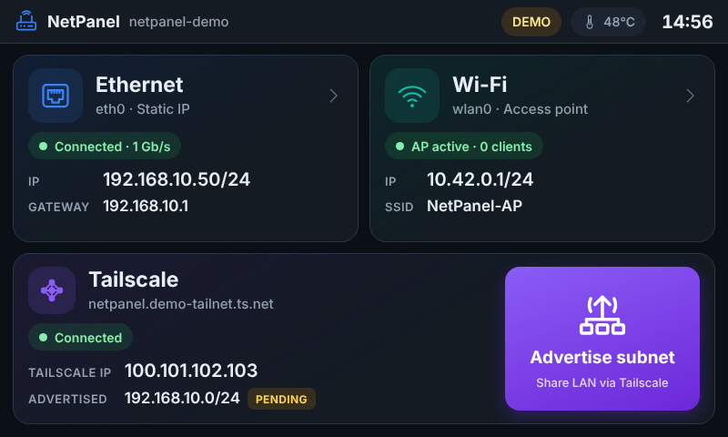

# NetPanel – dotykové síťové GUI pro Raspberry Pi 4 + Waveshare 5" DSI LCD

NetPanel je jednoduchá kiosková aplikace pro **Raspberry Pi 4** s dotykovým displejem
**Waveshare 5inch DSI LCD (800 × 480, kapacitní dotyk)** a **Raspberry Pi OS 12 „Bookworm“**.
Přehledně ukazuje stav sítě a umožňuje ji nastavit přímo z displeje:

- **Ethernet** – přepínač **DHCP / Static IP**; v režimu DHCP vidíš IP, masku, bránu a DNS, které rozhraní dostalo.
- **Wi-Fi** – přepínač **Station / Access Point**
  - *Station*: sken okolních sítí, připojení k Open / WPA2-Personal / WPA3-Personal síti, skrytá síť, DHCP nebo statická IP.
  - *Access Point*: SSID, heslo (WPA2), pásmo 2,4 / 5 GHz, kanál, adresa AP; klienti dostanou IP z DHCP a internet přes eth0 (NAT).
- **Tailscale** – stav připojení a **Advertise subnet**: předvyplní subnet podle eth0 a po potvrzení provede
  `sudo tailscale set --advertise-routes=<síť>/<prefix>`.
- Vlastní **on-screen klávesnice** (numerická pro IP adresy, QWERTY pro SSID/hesla) – v kiosku žádná systémová klávesnice není.
- Běží jako **služba po bootu ve fullscreenu**; z dotykového displeje ji nejde zavřít ani minimalizovat.

GUI je v angličtině, tato dokumentace v češtině.



| Ethernet (DHCP) | Wi-Fi – Station | Wi-Fi – Access Point |
|---|---|---|
|  |  |  |
| **Numerická klávesnice** | **QWERTY klávesnice** | **Tailscale – Advertise subnet** |
|  |  |  |

Všechny obrazovky jsou v [`docs/screenshots/`](docs/screenshots/) (vygenerované v demo režimu, 800 × 480).

> **Status: pracovní verze.** Kód je otestovaný unit testy a v demo režimu (simulovaný backend) v prohlížeči
> 800 × 480. **Na reálném Raspberry Pi s tímto displejem zatím otestovaný nebyl** – před nasazením
> do provozu ho musí ověřit odpovědná osoba (viz [Známá omezení](#známá-omezení-a-kritické-poznámky)).

---

## Obsah

1. [Jak to funguje](#jak-to-funguje)
2. [Struktura projektu](#struktura-projektu)
3. [Požadavky](#požadavky)
4. [Instalace krok za krokem](#instalace-krok-za-krokem)
5. [Co přesně dělá instalátor](#co-přesně-dělá-instalátor)
6. [Kiosk: služba po bootu, fullscreen, nejde zavřít](#kiosk-služba-po-bootu-fullscreen-nejde-zavřít)
7. [Ovládání GUI](#ovládání-gui)
8. [Bezpečnost a oprávnění](#bezpečnost-a-oprávnění)
9. [Konfigurace](#konfigurace)
10. [Vývoj a testy na PC (demo režim)](#vývoj-a-testy-na-pc-demo-režim)
11. [Řešení problémů](#řešení-problémů)
12. [Známá omezení a kritické poznámky](#známá-omezení-a-kritické-poznámky)
13. [Aktualizace a odinstalace](#aktualizace-a-odinstalace)
14. [Licence a zdroje](#licence-a-zdroje)

---

## Jak to funguje

```
 ┌───────────────────────── Raspberry Pi 4 ──────────────────────────────┐
 │                                                                       │
 │  tty1 ─ netpanel-kiosk.service (uživatel netpanel)                    │
 │          cage  ── Wayland kiosk kompozitor: 1 okno přes celý displej │
 │           └─ Chromium --kiosk http://127.0.0.1:8088                   │
 │                │  HTML/CSS/JS, ikony SVG, on-screen klávesnice         │
 │                ▼  JSON API (jen localhost)                            │
 │  netpanel.service (uživatel netpanel)                                 │
 │          python3 -m netpanel   ── jen standardní knihovna Pythonu     │
 │           ├─ nmcli ──────────▶ NetworkManager (povoleno polkit pravidlem)
 │           ├─ tailscale status ▶ tailscaled (čtení bez root)           │
 │           └─ sudo netpanel-ts-routes ▶ tailscale set --advertise-routes
 └───────────────────────────────────────────────────────────────────────┘
```

Proč takhle:

| Rozhodnutí | Důvod |
|---|---|
| **NetworkManager (`nmcli`)** | Bookworm ho má jako výchozí správce sítě. Umí DHCP/static, Wi-Fi klienta i AP (`ipv4.method shared` = DHCP server + NAT) – bez ručního hostapd/dnsmasq. |
| **Vlastní NM profily** `netpanel-eth`, `netpanel-ap`, `netpanel-sta` | NetPanel nesahá na tvoje existující profily. Priorita autoconnect (100 / 100 / 50) zajistí, že po rebootu platí to, co bylo naposledy nastaveno v GUI. |
| **Webové UI v Chromiu** | Bohaté touch ovládání, ostré SVG ikony, žádné pip balíčky (backend je čistá stdlib Pythonu). Cena: Chromium ≈ 200–300 MB RAM. |
| **cage** | Kiosk kompozitor – zobrazí jedinou aplikaci přes celý displej, nemá panely, tlačítka oken ani přepínání aplikací. |
| **Neprivilegovaný uživatel `netpanel`** | GUI neběží jako root. NetworkManager povoluje polkit pravidlo, Tailscale jediný root helper přes sudo. |

## Struktura projektu

```
RPI-5inchLCD-Net/
├── README.md                     tento soubor
├── netpanel/                     backend (Python 3.11 stdlib)
│   ├── __main__.py               start: python3 -m netpanel [--demo]
│   ├── server.py                 HTTP server, JSON API, statické soubory, bezpečnostní hlavičky
│   ├── validation.py             validace IP/masek/SSID/hesel/rout (autoritativní)
│   ├── models.py                 datové struktury
│   └── backend/
│       ├── network.py            NetworkManager přes nmcli (eth, Wi-Fi AP/Station, scan, rollback)
│       ├── nmparse.py            parser výstupu `nmcli -t`
│       ├── tailscale.py          tailscale status + advertise routes
│       ├── system.py             hostname, teplota CPU
│       ├── runner.py             spouštění příkazů (timeouty, logování, maskování hesel)
│       └── demo.py               simulovaný backend pro vývoj na PC
├── web/                          frontend (bez frameworku)
│   ├── index.html
│   ├── css/app.css, css/icons.css
│   ├── js/                       app.js (router), api.js, ui.js, keyboard.js, validate.js, pages/*.js
│   ├── icons/*.svg               vlastní ikony (ethernet, wifi, AP, station, VPN, subnet, …)
│   └── fonts/                    font Inter (SIL OFL 1.1)
├── deploy/
│   ├── install.sh / uninstall.sh
│   ├── netpanel.service          systemd: API server
│   ├── netpanel-kiosk.service    systemd: cage + Chromium na tty1
│   ├── kiosk.sh                  spouští Chromium v kiosk režimu
│   ├── netpanel.pam              PAM session pro kiosk (přístup k displeji a dotyku)
│   ├── 50-netpanel.rules         polkit: uživatel netpanel smí ovládat NetworkManager
│   ├── 50-netpanel.pkla          totéž pro starší polkit (fallback)
│   ├── netpanel.sudoers          sudo: jen /usr/local/sbin/netpanel-ts-routes
│   ├── netpanel-ts-routes        root helper: validace + tailscale set --advertise-routes
│   ├── 99-netpanel-ipforward.conf  sysctl: IP forwarding (nutné pro subnet router)
│   └── netpanel.default          /etc/default/netpanel (rozhraní, port)
├── tests/                        unit testy (Python + JS)
├── tools/screenshots.py          UI smoke test + screenshoty (Playwright, jen pro vývoj)
└── docs/screenshots/             obrázky obrazovek
```

## Požadavky

**Hardware**

- Raspberry Pi 4 (doporučeno ≥ 2 GB RAM; 1 GB funguje, ale Chromium je na hraně)
- Waveshare 5inch DSI LCD (800 × 480, kapacitní dotyk) připojený plochým kabelem do **DSI** konektoru
- microSD karta ≥ 16 GB, napájení 5 V / 3 A

**Software** (instalátor doinstaluje vše kromě Tailscale)

| Balíček | Účel |
|---|---|
| Raspberry Pi OS 12 Bookworm (Desktop **nebo** Lite), 64-bit doporučeno | OS |
| `network-manager`, `dnsmasq-base`, `nftables` | správa sítě, DHCP server a NAT pro AP (služba `nftables` zůstává vypnutá, NM používá jen nástroj `nft`) |
| `polkitd` | oprávnění uživatele `netpanel` k NetworkManageru |
| `python3` (3.11) | backend – **žádné pip balíčky** |
| `cage` | Wayland kiosk kompozitor |
| `chromium-browser` (resp. `chromium`) | zobrazení UI |
| `iw` | regulatorní doména Wi-Fi, počet klientů AP |
| `fonts-dejavu-core` | záložní font |
| `tailscale` | instaluje se zvlášť, viz krok 5 |

## Instalace krok za krokem

Příkazy se spouští na Raspberry Pi (přes SSH nebo lokálně s klávesnicí).

### 1. Příprava SD karty

1. V **Raspberry Pi Imager** zvol *Raspberry Pi 4* → *Raspberry Pi OS (64-bit)* (Desktop) nebo *Raspberry Pi OS Lite (64-bit)*.
2. V *OS customisation* nastav hostname, uživatele a heslo, **zapni SSH** a vyplň **Wireless LAN country = CZ**
   (bez země zůstane Wi-Fi v Bookworm zablokovaná přes rfkill).
3. Nabootuj Pi, připoj se přes SSH a aktualizuj systém:

```bash
sudo apt update && sudo apt full-upgrade -y
sudo reboot
```

> **SSH je po instalaci kiosku hlavní cesta ke správě.** tty1 už nebude ukazovat přihlašovací prompt.

### 2. Displej Waveshare 5inch DSI LCD

Podle [Waveshare wiki](https://www.waveshare.com/wiki/5inch_DSI_LCD) pro Pi 4 na Bookworm přidej na konec
`/boot/firmware/config.txt`:

```bash
sudo nano /boot/firmware/config.txt
```

```ini
dtoverlay=vc4-kms-v3d
#DSI1 Use
dtoverlay=vc4-kms-dsi-7inch
```

(Pokud tam `dtoverlay=vc4-kms-v3d` už je, podruhé ho nepřidávej.) Driver ani dotyk se samostatně neinstalují.
Restartuj a ověř:

```bash
sudo reboot
ls /sys/class/drm/            # má existovat něco jako card1-DSI-1
sudo apt install -y libinput-tools && sudo libinput list-devices | grep -A3 -i touch
```

Displej je nativně na šířku (800 × 480) – rotace není potřeba. Jas lze nastavit:
`echo 200 | sudo tee /sys/class/backlight/*/brightness` (0–255).

> ⚠️ Waveshare prodává několik 5" DSI variant. Uvedený overlay platí pro „5inch DSI LCD“ dle wiki výše;
> pro jinou revizi (např. „(C)“, „(D)“) se overlay liší – ověř na wiki svého modelu.

### 3. Ověř NetworkManager

```bash
systemctl is-active NetworkManager     # musí vypsat: active
nmcli device status                    # eth0 a wlan0 musí být "managed"
```

Pokud NetworkManager neběží (systém upgradovaný ze starší verze s dhcpcd):
`sudo raspi-config` → *Advanced Options* → *Network Config* → *NetworkManager* → reboot.

### 4. Wi-Fi země (pokud nebyla nastavená v Imageru)

```bash
sudo raspi-config nonint do_wifi_country CZ
iw reg get | head -3                   # má ukázat "country CZ"
```

(Instalátor to umí taky: `--wifi-country CZ`.)

### 5. Tailscale

Instalace z oficiálního repozitáře (skript přidá apt repozitář Tailscale a nainstaluje balíček):

```bash
curl -fsSL https://tailscale.com/install.sh | sh
sudo tailscale up
```

`tailscale up` vypíše URL – otevři ji na PC/mobilu a přihlas zařízení do svého tailnetu.
NetPanel samotné přihlášení nedělá (záměrně – login patří administrátorovi, ne dotykovému panelu).

Pro funkční **subnet router** musí platit dvě věci:

1. **IP forwarding** – nastaví instalátor (`/etc/sysctl.d/99-netpanel-ipforward.conf`).
2. **Schválení routy** v admin konzoli Tailscale: *Machines* → zařízení → *Edit route settings* → zaškrtnout subnet.
   Alternativně automaticky přes `autoApprovers` v ACL policy tailnetu. Dokud routa není schválená,
   NetPanel ji ukazuje jako **PENDING**.

### 6. Zkopíruj NetPanel na Raspberry Pi

Z PC (Windows PowerShell / Linux), ve složce, kde je tento projekt:

```bash
scp -r RPI-5inchLCD-Net <uživatel>@<ip-raspberry>:~/
```

(nebo přes USB disk / `git clone`, pokud projekt dáš do repozitáře).

### 7. Spusť instalátor

```bash
cd ~/RPI-5inchLCD-Net
chmod +x deploy/*.sh deploy/netpanel-ts-routes
sudo ./deploy/install.sh --wifi-country CZ
```

Volby instalátoru:

| Volba | Význam |
|---|---|
| `--wifi-country CZ` | nastaví regulatorní doménu Wi-Fi přes raspi-config |
| `--no-kiosk` | nainstaluje jen API službu (bez cage/Chromium a bez převzetí tty1) – pro testy |
| `--no-ipforward` | nezapne IP forwarding (Tailscale subnet routing pak nebude fungovat!) |
| `-y` | bez dotazů |

Instalátor je idempotentní – můžeš ho spustit znovu (také pro aktualizaci).

### 8. Restart → kiosk

```bash
sudo reboot
```

Po startu se na displeji objeví NetPanel přes celou obrazovku (start trvá cca 10–20 s, než naběhne Chromium).

### 9. Ověření

```bash
systemctl status netpanel netpanel-kiosk
journalctl -u netpanel -f                 # log API včetně každého spuštěného nmcli příkazu
journalctl -u netpanel-kiosk -b           # log cage/Chromium
curl -s http://127.0.0.1:8088/api/health  # {"ok": true, ...}
```

## Co přesně dělá instalátor

| Krok | Soubor / akce |
|---|---|
| Balíčky | `apt install python3 iw network-manager dnsmasq-base polkitd nftables sudo cage fonts-dejavu-core chromium-browser` |
| Uživatel | `netpanel` (domov `/var/lib/netpanel`, bez hesla, shell `nologin`), skupiny `video render input netdev` |
| Aplikace | `/opt/netpanel` (vlastník root, uživatel netpanel jen čte) |
| Tailscale helper | `/usr/local/sbin/netpanel-ts-routes` (root, 0755) |
| sudo | `/etc/sudoers.d/netpanel` – **jediný** povolený příkaz: helper výše (ověřeno `visudo -c`) |
| polkit | `/etc/polkit-1/rules.d/50-netpanel.rules` – netpanel smí akce `org.freedesktop.NetworkManager.*` |
| PAM | `/etc/pam.d/netpanel` – session pro kiosk (logind přidělí displej + dotyk) |
| sysctl | `/etc/sysctl.d/99-netpanel-ipforward.conf` – `net.ipv4.ip_forward=1`, `net.ipv6.conf.all.forwarding=1` |
| Konfigurace | `/etc/default/netpanel` (při upgradu se nepřepisuje) |
| systemd | `netpanel.service` (enable + start), `netpanel-kiosk.service` (enable, startuje po rebootu) |
| Boot | `systemctl set-default multi-user.target` (vypne desktop, pokud byl), `systemctl disable getty@tty1` |

## Kiosk: služba po bootu, fullscreen, nejde zavřít

Kiosk zajišťuje `netpanel-kiosk.service`:

- běží na **tty1** místo přihlašovacího promptu (`Conflicts=getty@tty1.service`),
- spouští **cage** – Wayland kompozitor pro jedinou aplikaci: žádný panel, žádná tlačítka okna, žádný Alt+Tab,
  okno je vždy přes celý displej; přepínání VT je vypnuté (cage bez `-s`),
- v cage běží **Chromium `--kiosk`** s vypnutým pinch-zoomem, swipe navigací, překladem, „restore pages“ bublinou;
  profil se při každém startu maže,
- stránka sama blokuje kontextové menu (dlouhý stisk), výběr textu, zoom a navigaci zpět,
- `Restart=always` – pokud by Chromium/cage spadl, systemd ho do 3 s spustí znovu.

Z dotykového displeje tedy aplikaci **nejde zavřít ani minimalizovat**. (S připojenou USB klávesnicí jsou
běžné zkratky prohlížeče blokované stránkou; 100% to ale není – viz omezení.)

### Jak se dostat „ven“ (údržba přes SSH)

```bash
sudo systemctl stop netpanel-kiosk        # dočasně zastaví kiosk
sudo systemctl start getty@tty1           # přihlašovací prompt na displeji
sudo systemctl start netpanel-kiosk       # zpět do kiosku

# trvale vypnout kiosk a vrátit desktop (u verze s desktopem):
sudo systemctl disable --now netpanel-kiosk
sudo systemctl enable getty@tty1
sudo systemctl set-default graphical.target && sudo reboot
```

## Ovládání GUI

**Home** – dvě dlaždice nahoře (Ethernet, Wi-Fi) s aktuálním stavem, IP a bránou/SSID; dole sekce Tailscale
s IP v tailnetu, advertised routou (APPROVED / PENDING) a velkým tlačítkem **Advertise subnet**.
Stav se obnovuje každé 4 s. Vpravo nahoře teplota CPU a čas.

**Ethernet** – vlevo stav linky (rychlost, MAC, profil, DNS), vpravo přepínač **DHCP / Static IP**.
V DHCP jsou pole jen pro čtení a ukazují hodnoty od DHCP serveru. Ve Static IP se pole předvyplní aktuálními
hodnotami; klepnutím na pole se otevře numerická klávesnice (s předvolbami masek, návrhem brány `.1`
a DNS 1.1.1.1 / 8.8.8.8 / 9.9.9.9). **Apply** → potvrzovací dialog se souhrnem → aplikace (max. ~40 s).
Při odpojeném kabelu se nastavení jen uloží a použije se po připojení.

**Wi-Fi** – v hlavičce přepínač **Station / Access Point** (přepíná jen zobrazení; změna se provede až potvrzením).

- *Station*: seznam sítí se silou signálu, zabezpečením, pásmem a kanálem; **Scan**, **Hidden network**.
  Po výběru sítě: heslo (QWERTY klávesnice, tlačítko oka pro zobrazení), DHCP nebo statická IP, **Connect**.
  Nová síť se nejdřív zkouší v dočasném profilu `netpanel-sta-new`; uloží se až po úspěšném připojení.
  Když připojení selže (např. špatné heslo), dočasný profil se smaže a **vrátí se předchozí spojení** (i běžící AP).
- *Access Point*: SSID, heslo (navržené náhodné), pásmo 2,4/5 GHz, kanál (2,4 GHz: 1–13; 5 GHz: 36/40/44/48),
  adresa AP (výchozí `10.42.0.1/24`). Klienti dostanou IP z DHCP a internet přes eth0 (NAT).
  Kontroluje se, že se subnet AP nepřekrývá s eth0 a že kanál odpovídá nastavené Wi-Fi zemi (bez země jen 2,4 GHz kanály 1–11).
  Změna AP se také nejdřív zkouší v dočasném profilu – když se AP nespustí, původní nastavení zůstane.
  **Stop AP** vrátí Wi-Fi do režimu station.

**Tailscale** – vlevo stav (přihlášení, Tailscale IP, advertised / aktivní routy, IP forwarding), vpravo
**Network address** + **Prefix** předvyplněné podle eth0 (např. `192.168.10.57/24` → `192.168.10.0/24`;
hostitelské bity se vynulují automaticky – Tailscale by jinak příkaz odmítl). Náhled přesného příkazu
`sudo tailscale set --advertise-routes=…` je vidět ještě před potvrzením. **Stop advertising** routy zruší.

> `--advertise-routes` **nahrazuje** celý seznam advertised rout – dialog na to upozorní, pokud už nějaká jiná routa existuje.

Spuštěné příkazy (pro kontrolu v `journalctl -u netpanel`), např.:

```text
nmcli connection modify netpanel-eth connection.interface-name eth0 ... ipv4.method manual ipv4.addresses 192.168.10.50/24 ipv4.gateway 192.168.10.1 ipv4.dns "1.1.1.1 8.8.8.8"
nmcli --wait 40 connection up netpanel-eth
nmcli connection add type wifi ifname wlan0 con-name netpanel-ap ssid NetPanel-AP 802-11-wireless.mode ap ipv4.method shared ... 802-11-wireless-security.psk ******
sudo -n /usr/local/sbin/netpanel-ts-routes 192.168.10.0/24   →   tailscale set --advertise-routes=192.168.10.0/24
```

Hesla se v logu maskují (`******`).

## Bezpečnost a oprávnění

- **API poslouchá jen na `127.0.0.1:8088`** – ze sítě není dostupné. Kontroluje hlavičku `Host` (ochrana proti
  DNS rebinding), POST vyžaduje hlavičku `X-NetPanel: 1` + JSON (cizí web ji nemůže poslat bez CORS, který se
  nepovoluje), stránka má striktní Content-Security-Policy.
- **Žádný kód neběží jako root** kromě malého helperu `netpanel-ts-routes`, který znovu validuje vstup
  (kanonická síť, žádné `/0`, loopback, multicast, link-local ani `100.64.0.0/10`) a teprve pak volá `tailscale set`.
  sudoers povoluje uživateli `netpanel` **jen tento helper**, ne celý `tailscale`.
- **NetworkManager** povoluje polkit pravidlo pro uživatele `netpanel` (akce `org.freedesktop.NetworkManager.*`).
- Všechny vstupy se validují dvakrát (UI pro okamžitou odezvu, server autoritativně); příkazy se spouštějí bez shellu.

Rizika, o kterých máš vědět:

- **Kdo má fyzický přístup k displeji, může měnit síť** – to je účel zařízení. Panel nemá PIN.
- Heslo Wi-Fi se při volání `nmcli` předává jako argument a je na okamžik vidět v `ps` lokálním uživatelům.
  Na jednoúčelovém zařízení bez dalších uživatelů je to přijatelné, v logu je maskované.
- Heslo AP je v GUI vidět v čitelné podobě (aby ho šlo nadiktovat) – skryješ ho ikonou oka.
- Polkit pravidlo dává uživateli `netpanel` plnou správu NetworkManageru. Kompromitace tohoto účtu = změna sítě.
- API na `127.0.0.1` nemá přihlášení: **jakýkoli lokální proces/uživatel na Pi** ho může volat a měnit síť
  i Tailscale routy. Proti webovým stránkám a síti je chráněné, proti lokálním uživatelům ne – na Pi proto
  nedávej účty lidem, kteří nemají mít správu sítě.

## Konfigurace

`/etc/default/netpanel`:

```ini
NETPANEL_ETH=eth0        # název ethernet rozhraní
NETPANEL_WLAN=wlan0      # název Wi-Fi rozhraní
NETPANEL_PORT=8088       # port API (jen localhost)
#NETPANEL_LOG=DEBUG      # podrobnější log
```

Po změně: `sudo systemctl restart netpanel netpanel-kiosk`.

Ladění UI na dálku (bez otevírání portu do sítě) přes SSH tunel:

```bash
ssh -L 8088:127.0.0.1:8088 <uživatel>@<ip-raspberry>
# a v prohlížeči na PC: http://localhost:8088  (POZOR: ovládá skutečnou síť Raspberry)
```

## Vývoj a testy na PC (demo režim)

Backend potřebuje jen Python ≥ 3.9 (na Pi je 3.11). Demo režim nic nemění, všechno simuluje:

```bash
python3 -m netpanel --demo
# otevři http://127.0.0.1:8088 a nastav okno prohlížeče na 800 × 480 (DevTools → device toolbar)
```

V demu lze vyzkoušet i chybové stavy: heslo `wrongpass` při připojení k Wi-Fi simuluje špatné heslo
(dialog + návrat k předchozímu spojení).

Testy:

```bash
python3 -m unittest discover -s tests -t .     # validace, parser nmcli, příkazy nmcli + rollback, HTTP API
node tests/test_validate.mjs                    # validace ve frontendu
python3 tools/screenshots.py                    # průchod UI + screenshoty (vyžaduje Playwright + Chromium)
```

## Řešení problémů

| Příznak | Příčina / řešení |
|---|---|
| Displej černý, na SSH `systemctl status netpanel-kiosk` ukazuje restartování | `journalctl -u netpanel-kiosk -b`. Častá příčina: displej nedetekovaný (`ls /sys/class/drm` bez `DSI`) → zkontroluj `config.txt` a kabel. Nebo běží desktop: `systemctl get-default` musí být `multi-user.target`. |
| cage: „Unable to open seat“ / „Could not take control of session“ | PAM session nevznikla: existuje `/etc/pam.d/netpanel`? Nekoliduje getty na tty1 (`systemctl status getty@tty1`)? |
| Chromium: „Chromium not found“ | `sudo apt install chromium-browser` (případně `chromium`). |
| Na displeji „NetPanel service is not responding“ | `systemctl status netpanel`, `journalctl -u netpanel -e`. |
| Dotyk nereaguje | `sudo libinput list-devices` – musí tam být touchscreen; zkontroluj kabel a `disable_touchscreen` v `config.txt`. |
| cage startuje, ale displej zůstane černý | Pi 4 má dvě DRM zařízení (v3d a vc4). Pokud cage vybere špatné, přidej do `/etc/default/netpanel` řádek `WLR_DRM_DEVICES=/dev/dri/card1` (číslo karty s `DSI` v `ls /sys/class/drm`) a restartuj kiosk. |
| Hlášky „Not authorized“ / „Insufficient privileges“ při ukládání sítě | polkit pravidlo: existuje `/etc/polkit-1/rules.d/50-netpanel.rules`? `sudo systemctl restart polkit`. |
| Wi-Fi „Blocked (rfkill)“ | Nenastavená země: `sudo raspi-config nonint do_wifi_country CZ`, `rfkill list`, reboot. |
| AP běží, ale klienti se nepřipojí | Zkus 2,4 GHz kanál 1/6/11; telefon „zapomene“ síť a připojí se znovu; NetPanel vypíná PMF (známý problém brcmfmac). Log: `journalctl -u NetworkManager -b`. |
| AP klienti mají IP, ale ne internet | eth0 musí mít funkční uplink (brána). NAT dělá NetworkManager (`ipv4.method shared`); ověř `cat /proc/sys/net/ipv4/ip_forward` = 1. |
| AP: „5 GHz needs the Wi-Fi country set“ / kanál nepovolen | Nastav zemi: `sudo raspi-config nonint do_wifi_country CZ`, reboot. |
| Ethernet DHCP: „no DHCP lease within 60 s“ | Nastavení je uložené, NetworkManager zkouší dál. Zkontroluj DHCP server nebo použij statickou IP. |
| Scan nic nenajde | V režimu AP scan nejde (UI to hlásí). Po přepnutí z AP chvíli počkej a dej Scan znovu. |
| „Permission denied for 'tailscale set'“ | Chybí `/etc/sudoers.d/netpanel` nebo helper → spusť znovu `deploy/install.sh`. Test: `sudo -u netpanel sudo -n /usr/local/sbin/netpanel-ts-routes --clear`. |
| Routa je pořád PENDING | Schval ji v Tailscale admin konzoli (nebo `autoApprovers`). |
| Tailscale „Needs login“ | `sudo tailscale up` přes SSH. |
| `install.sh`: „/bin/bash^M: bad interpreter“ | Soubory byly uloženy s Windows konci řádků (CRLF). Oprava na Pi: `sed -i 's/\r$//' deploy/*.sh deploy/netpanel-ts-routes deploy/*.service deploy/netpanel.*` |
| Po změně IP na eth0 jsem ztratil SSH | Očekávané – SSH běželo přes starou adresu. Připoj se na novou IP (je vidět na displeji). |

## Známá omezení a kritické poznámky

Tohle je poctivý seznam slabin – rozhodni, co z toho je pro tvoje nasazení problém:

1. **Neotestováno na reálném HW.** Testováno: unit testy (43), parsování výstupu `nmcli`, generované příkazy,
   rollback, HTTP API a celé UI v Chromiu 800 × 480 s demo backendem; kód prošel nezávislou revizí.
   Výstup `nmcli` se čte s `--escape no` – formát se mezi verzemi NetworkManageru může mírně lišit. Neověřeno: chování na Pi 4 s tímto
   displejem, konkrétní verze `nmcli`/`cage`/`chromium` v tvém image. **První nasazení dělej s SSH po ruce.**
2. **Konfigurace přes dotyk = konfigurace pro kohokoli u displeje.** Pokud zařízení visí ve veřejném prostoru,
   přidej PIN/zámek (dnes není).
3. **Jedna Wi-Fi karta = buď AP, nebo klient.** Současný provoz AP + station na jednom rádiu NetPanel nepodporuje.
   Pro uplink přes Wi-Fi a zároveň AP je potřeba druhý (USB) adaptér.
4. **Uplink pro AP je eth0.** Když eth0 nemá internet, klienti AP ho mít nebudou.
5. **WPA2/WPA3-Enterprise (802.1X), WEP a OWE nejsou podporované** (síť se v seznamu ukáže jako „not supported“).
   WPA3-SAE na Wi-Fi čipu Pi 4 závisí na firmware – pokud připojení selže, použij WPA2.
6. **5 GHz AP jen kanály 36–48** (bez DFS). Pi 4 v režimu AP neumí detekci radaru, takže DFS kanály
   v EU nejdou.
7. **Station režim si pamatuje jen jednu síť** (`netpanel-sta`). Ostatní existující NM profily zůstávají a mohou
   se použít jako záloha.
8. **`--advertise-routes` nahrazuje seznam rout.** GUI umí jednu routu; jiné routy přidané ručně se přepíšou.
9. **Chromium je těžký** (RAM, ~10–20 s start). Alternativa bez prohlížeče (PyQt/Qt) by byla lehčí, ale
   s vlastní klávesnicí a stylováním pracnější.
10. **USB klávesnice:** stránka blokuje běžné zkratky (Ctrl+W, Ctrl+L, F5, F11 …), cage nepovoluje přepnutí VT.
    Absolutní ochrana proti člověku s klávesnicí to ale není – kdo má fyzický přístup a klávesnici,
    může např. odpojit napájení.
11. **IP forwarding se zapíná globálně** (nutné pro subnet router). Pi tím začne routovat mezi rozhraními –
    pokud je eth0 v síti, kde to vadí, zvaž firewall.
12. **Ethernet:** změny se aplikují ihned. NetPanel nedělá automatický rollback po ztrátě konektivity u eth0
    (na rozdíl od Wi-Fi, kde se při selhání připojení vrací předchozí spojení). Špatná statická IP zůstane
    uložená – oprav ji na displeji.
13. **Kanály AP podle země jsou zjednodušené** (bez země / US: 1–11; jinak 1–13; 5 GHz jen 36–48).
    Skutečné povolení kanálu ověřuje až ovladač – když AP nenaběhne, zkus jiný kanál.
14. **`tailscale debug prefs`** (čtení advertised rout) je skrytý ladicí příkaz Tailscale; jeho formát se může
    v budoucích verzích změnit. Exit-node routy (`0.0.0.0/0`, `::/0`) NetPanel v seznamu nezobrazuje.

## Aktualizace a odinstalace

Aktualizace: nahraj novou verzi projektu na Pi a spusť znovu `sudo ./deploy/install.sh`, pak
`sudo systemctl restart netpanel netpanel-kiosk`.

Odinstalace:

```bash
sudo ./deploy/uninstall.sh            # služby, sudo, polkit, PAM pryč; /opt/netpanel a uživatel zůstanou
sudo ./deploy/uninstall.sh --purge    # odstraní i /opt/netpanel, /etc/default/netpanel, sysctl soubor a uživatele
```

NetworkManager profily `netpanel-eth`, `netpanel-ap`, `netpanel-sta` zůstávají (jsou to tvoje síťová nastavení).
Smazání: `sudo nmcli connection delete netpanel-ap` apod.

## Licence a zdroje

- Ikony v `web/icons/` jsou vlastní (vytvořené pro tento projekt). Ikona Tailscale sekce je obecný „VPN mesh“
  symbol, ne logo Tailscale.
- Font **Inter** © The Inter Project Authors, licence SIL Open Font License 1.1 – viz `web/fonts/OFL.txt`.
- Zdroje použité při návrhu:
  [Waveshare 5inch DSI LCD wiki](https://www.waveshare.com/wiki/5inch_DSI_LCD),
  [cage – Starting Cage on boot with systemd](https://github.com/cage-kiosk/cage/wiki/Starting-Cage-on-boot-with-systemd),
  [tailscale set](https://tailscale.com/kb/1241/tailscale-set),
  [Tailscale subnet routers](https://tailscale.com/kb/1019/subnets).
